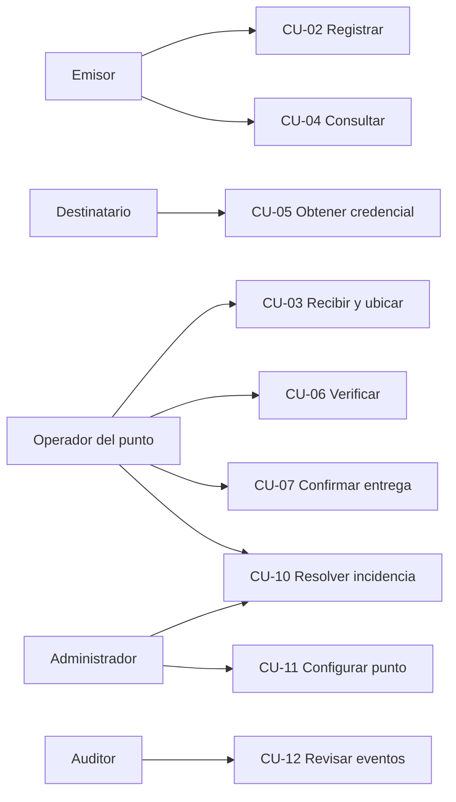
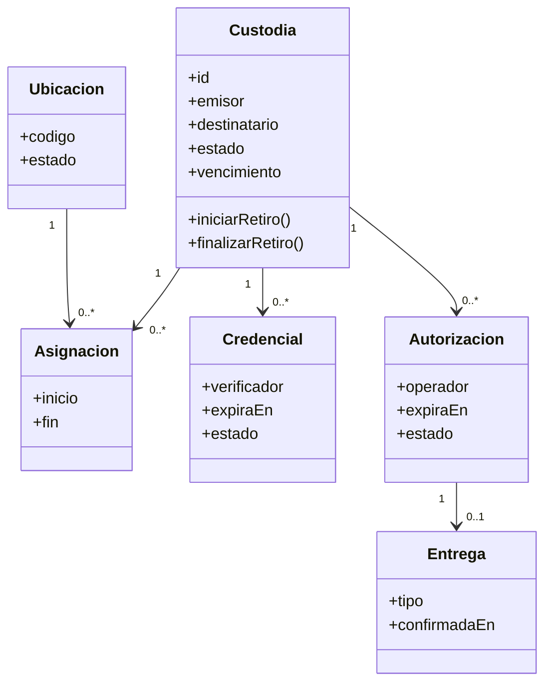
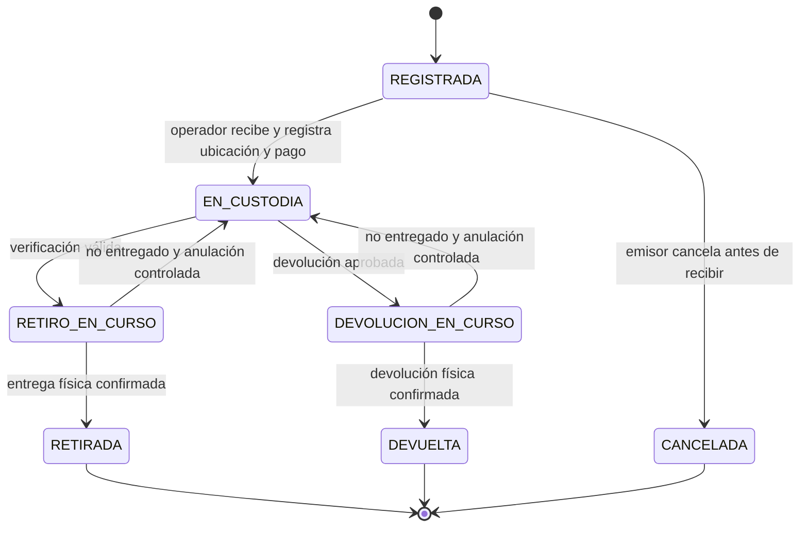
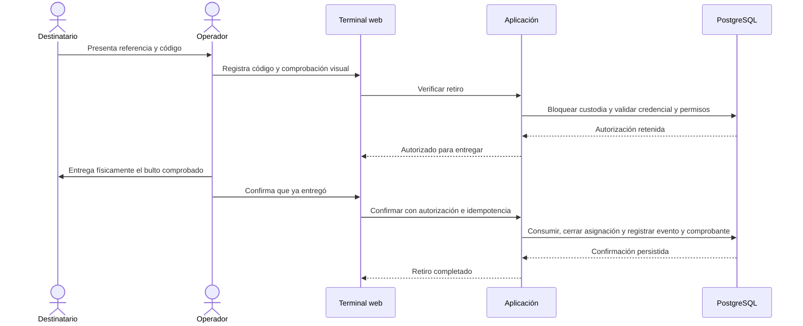
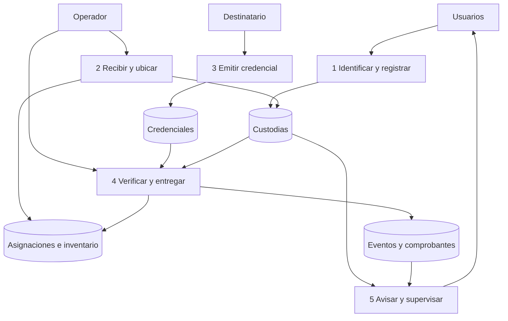

# Modelado de análisis: escenarios, clases, comportamiento y flujo

Estado: diseño. Referentes: Pressman y Maxim [I01], Cockburn [I02] y Larman [I03]. Definiciones normativas: [especificación](BuzonExpress_Especificacion_Software.md).

## 1. Escenario principal y fronteras

Una persona registra un objeto para otra. El operador comprueba condiciones y capacidad, cobra el servicio y registra la recepción. El destinatario obtiene una credencial y acude al punto. El operador verifica, entrega el objeto y confirma la entrega. El sistema conserva evidencia y libera la ubicación.

La frontera del software termina en el registro y autorización. Recepción material, custodia del espacio y entrega humana pertenecen al proceso del servicio; se representan como interacciones con el operador, no como sensores o actuadores implícitos.

Esta es una vista de relaciones actor–capacidad en Mermaid, no un diagrama UML formal de casos de uso. Las descripciones completas están en [casos de uso](06_casos_de_uso_alto_nivel_y_expandidos.md).

## 2. Análisis boundary, control y entity

| Categoría | Elementos | Responsabilidad |
|---|---|---|
| Límite | Registro web, terminal, consulta, tablero. | Capturar intención y mostrar resultado y errores. |
| Control | RegistrarCustodia, RecibirCustodia, VerificarRetiro, ConfirmarEntrega. | Coordinar permisos, reglas y transacción. |
| Entidad | Custodia, Asignación, Credencial, Autorización, Entrega. | Conservar estado e invariantes propios. |
| Servicio externo al dominio | Reloj, sesión, correo, base de datos. | Implementar mecanismos mediante interfaces. |

GRASP se aplica asignando información y responsabilidades: la custodia determina si puede pasar a retiro; la credencial conoce vigencia y propósito; la aplicación coordina la unidad de trabajo. La UI no autoriza y el repositorio no cobra por su cuenta.

## 3. Tarjetas CRC

| Clase | Responsabilidades | Colaboradores |
|---|---|---|
| Custodia | Conservar participantes, condiciones, estados y fechas; rechazar transición inválida. | Asignación, Autorización, Evento. |
| Asignación | Vincular una custodia con una ubicación durante un intervalo. | Ubicación, Custodia. |
| Credencial | Vincular verificador, propósito, intentos, vigencia y revocación. | Autorización, Reloj. |
| Autorización | Retener el derecho de entrega para un operador y periodo concretos. | Credencial, Custodia, Entrega. |
| ConfirmarEntrega | Comprobar autorización, registrar comprobante y liberar asignación en una transacción. | UnidadDeTrabajo, repositorios, Reloj. |
| Notificador | Procesar avisos pendientes y registrar intentos. | Repositorio de avisos, Correo. |
| Recuperación | Solicitar y registrar decisión de una excepción sin autoaprobación. | Incidencia, Administrador, Evento. |

## 4. Modelo conceptual de clases

Las multiplicidades permiten historial; los índices restringen a una asignación activa por ubicación y custodia. El diagrama conceptual no sustituye el diccionario físico.

## 5. Máquina de estados

Los estados en curso no se cancelan automáticamente por vencimiento: una persona debe comprobar si hubo entrega. Si la respuesta es incierta se conserva el bloqueo y se abre incidencia. `VENCIDA` no es estado de custodia: se deriva del plazo para no perder información sobre posesión del objeto.

## 6. Secuencia de retiro asistido

La transacción no permanece abierta mientras el operador camina al estante. Las dos acciones usan transacciones cortas. Si la segunda falla tras entregar físicamente, la terminal informa “confirmación pendiente” y remite a conciliación; no solicita entregar otra vez.

## 7. Modelado de flujo

Contexto del servicio: emisor entrega datos y objeto al operador; destinatario presenta autorización; administrador configura y resuelve; software registra operaciones y emite avisos. Se diferencia el flujo material del flujo de información.

## 8. Escenarios de análisis adicionales

| Escenario | Resultado esperado |
|---|---|
| Dos operadores seleccionan la última ubicación. | Una recepción se confirma; la otra recibe conflicto sin cobrar digitalmente ni dejar una custodia parcialmente recibida. |
| Código válido de otra custodia. | Rechazo sin revelar qué parte de la credencial coincidió. |
| Destinatario desconoce código. | Puede reemitir desde su cuenta; una excepción presencial requiere recuperación aprobada. |
| Objeto no aparece en ubicación registrada. | Bloqueo e incidencia; no confirmar entrega ni liberar espacio. |
| Se agotó el plazo. | Se informa la prórroga pendiente, se mantiene posesión y ubicación. |
| Confirmación repetida. | Mismo resultado existente sin nuevo comprobante o cobro. |
| Operador entregó y perdió conexión. | Mantener registro en curso, advertir al personal y reconciliar sin repetir la entrega. |

Estos escenarios alimentan las pruebas y el manual; no se resuelven agregando estados ambiguos ni mensajes de éxito locales.
