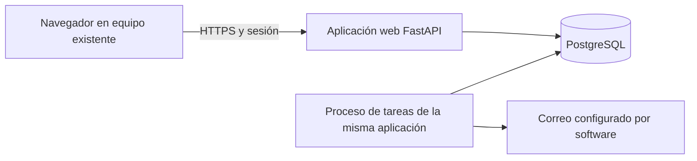
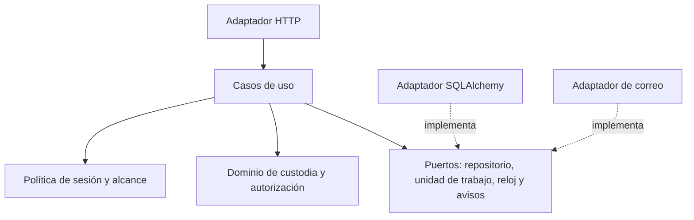
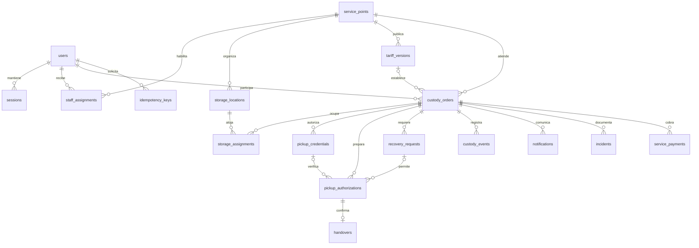

# Modelo de datos y arquitectura

Estado: arquitectura de referencia de la implementación actual. La solución usa React/TypeScript, FastAPI, SQLAlchemy, Alembic y PostgreSQL, dentro de una aplicación modular. Los límites y las decisiones se contrastan con Evans, Martin, Fowler, Brown, Codd y Date; ver [aplicación de marcos](../metodologia/01_marcos_y_aplicacion.md).

La línea base 1.1 reconstruye el SQL de referencia a partir del diccionario y las reglas documentadas. Conserva 156 definiciones de columna y explicita las claves compuestas, la ocupación activa única y la protección de eventos. La aplicación cuenta con dos revisiones Alembic; el verificador canónico aplica el esquema y sus invariantes en PostgreSQL 16 aislado. Las transiciones y los permisos ya están implementados en los módulos de dominio, aplicación y API. La evidencia y sus límites están en el [registro de pruebas](../validacion/resultados_pruebas.csv).

## 1. Componentes y dependencias

La aplicación está organizada en módulos de identidad, custodia e inventario, autorización de entrega, cobros del servicio, comunicaciones y supervisión. Comparten una unidad de despliegue y límites explícitos.

El código separa reglas y estados del dominio, coordinación de casos de uso, API, persistencia y correo. El ORM, el transporte de correo y las cookies quedan en adaptadores. Las pruebas de reglas usan dobles cuando corresponde; la integridad se comprueba también con PostgreSQL.

### Contexto C4, representado con Mermaid


### Contenedores C4



Los cuadros representan responsabilidades de ejecución; no todos requieren contenedores Docker. El proceso de tareas puede ser un comando programado de la misma aplicación, sin intermediario de mensajes obligatorio.

### Componentes internos



## 2. Límites e invariantes

- Custodia es el agregado de estado y participantes. La identidad de personas se referencia, sin copiar contraseñas.
- Asignación representa el intervalo real de ocupación. No hay una reserva en el registro previo.
- La ubicación pertenece a un punto y admite una asignación activa. Dos índices parciales impiden duplicar ubicación o custodia activa.
- Credencial y autorización se separan. La primera prueba conocimiento de un secreto ligado al objeto; la segunda retiene la operación para un operador durante la entrega.
- Un comprobante final por custodia y autorización evita doble salida. Una devolución final usa el mismo principio.
- La bitácora acompaña los cambios; el estado actual relacional sigue siendo fuente operativa. No se implementa Event Sourcing.
- Los avisos pendientes se insertan en la misma transacción y actúan como salida transaccional. Un proceso separado realiza el correo y registra aceptación o fallo.

## 3. Diagrama entidad–relación



La relación de usuarios con custodia comprende dos claves distintas: emisor y destinatario. El SQL enumera ambas y añade referencias compuestas para que ubicación, autorización y custodia pertenezcan al mismo contexto.

## 4. Normalización y decisiones históricas

Dependencias principales: `user.id → atributos de cuenta`; `(point_id, code) → ubicación`; `custody.id → participantes, punto y estado`; `assignment.id → custodia, ubicación e intervalo`; `tariff.id → reglas y vigencia`. Los cobros se registran aparte para no repetir columnas por cada pago.

La descripción del punto no se duplica en custodias. La copia `tariff_snapshot` conserva el contrato aceptado aunque cambie la tarifa; es una duplicación histórica deliberada. No se afirma BCNF de todas las relaciones por usar UUID. Las consultas de saldo suman pagos registrados y restan reembolsos; no se almacena un saldo editable sin conciliación.

`public_reference_hash` corresponde a una referencia aleatoria de alta entropía entregada por un canal permitido, distinta de la guía. El código de retiro no aparece en ninguna tabla: solo se conserva su verificador. No se guardan fotos de documentos.

## 5. Transacciones y concurrencia

Recepción: autorizar actor; bloquear custodia y ubicación con `SELECT ... FOR UPDATE`; comprobar versión, tamaño y disponibilidad; insertar asignación y cobro; actualizar estado y precio; agregar eventos y avisos; confirmar una sola vez. El repositorio no ejecuta un `commit` independiente por tabla.

Retiro: primera transacción valida credencial y crea autorización; segunda transacción, después de la entrega humana, consume autorización, cierra asignación, actualiza ubicación y custodia y agrega comprobante y eventos. No se deja un bloqueo SQL abierto durante el trabajo del operador.

Ejemplo de actualización optimista:

```sql
UPDATE custody_orders
SET state = 'RETIRO_EN_CURSO', version = version + 1
WHERE id = :custody_id AND version = :expected_version
  AND state = 'EN_CUSTODIA';
-- Cero filas implica conflicto. No continuar con la autorización.
```

La versión sirve cuando la condición se comprueba y se rechaza el conflicto. Los índices únicos son una segunda barrera. La condición “sin incidencia bloqueante” y el saldo se revisan bajo la misma política de concurrencia; no basta una consulta anterior desde la UI.

## 6. Entrega humana, fallas y recuperación

La entrega física y una transacción SQL no son atómicas. Una autorización caducada no permite inferir si el objeto sigue guardado. El estado en curso bloquea otra entrega y requiere comprobación humana. Si hubo entrega, una recuperación aprobada permite completar el comprobante con referencia al expediente; si no hubo, se anula y revoca la credencial antes de habilitar una nueva. Si no se sabe, permanece bloqueada la operación.

Una conciliación documentada puede confirmar una autorización expirada; es una excepción del caso de uso de recuperación, nunca del endpoint ordinario. Su aprobador debe ser distinto del solicitante y el historial conserva ambas fechas: hecho declarado y confirmación persistida.

## 7. Operación de datos

Las migraciones Alembic versionadas parten de una base de prueba vacía y se ensayan con aplicación, reversión y nueva aplicación. El [SQL](anexos/modelo_propuesto.sql) es el modelo de referencia usado para verificar las 17 tablas y sus invariantes; no se aplica sobre la base de otro sistema. Una migración de datos comerciales requiere inventario físico, correspondencia de participantes y revisión manual; no reutiliza contraseñas.

Copias y restauración se ensayan antes del piloto. Los eventos no se editan con la cuenta de aplicación; un trigger adicional rechaza UPDATE y DELETE, con límites frente a un propietario de base. La conservación y anonimización requieren una política aprobada para el servicio antes de uso público.

## 8. Diccionario físico completo

El diccionario siguiente se genera desde el SQL de referencia. Cada fila conserva tipo, nulabilidad, clave o condición declarada y su propósito. Las restricciones de varias columnas e índices se consultan en el SQL. Las reglas de autorización y aquellas que abarcan varias tablas requieren lógica de aplicación y pruebas; no se declaran cubiertas únicamente por CHECK.

<!-- DICCIONARIO_GENERADO -->

### Tabla `users`

| Campo | Definición SQL | Propósito |
|---|---|---|
| `id` | `UUID PRIMARY KEY` | Identificador de cuenta. |
| `email` | `VARCHAR(254) NOT NULL UNIQUE` | Correo normalizado; no directorio público. |
| `full_name` | `VARCHAR(160) NOT NULL` | Nombre declarado del participante. |
| `phone` | `VARCHAR(24)` | Contacto normalizado opcional. |
| `password_hash` | `TEXT NOT NULL` | Verificador adaptativo; nunca contraseña plana. |
| `role` | `VARCHAR(16) NOT NULL CHECK (role IN ('USUARIO','OPERADOR','ADMIN','AUDITOR'))` | Permiso global. |
| `contact_verified_at` | `TIMESTAMPTZ` | Comprobación por correo o presencial. |
| `contact_verification_hash` | `CHAR(64)` | Hash de enlace de verificación pendiente. |
| `verification_expires_at` | `TIMESTAMPTZ` | Vigencia del enlace de comprobación. |
| `password_reset_hash` | `CHAR(64)` | Hash de enlace de recuperación de cuenta. |
| `password_reset_expires_at` | `TIMESTAMPTZ` | Vigencia de recuperación de cuenta. |
| `is_active` | `BOOLEAN NOT NULL DEFAULT TRUE` | Habilitación de cuenta. |
| `created_at` | `TIMESTAMPTZ NOT NULL DEFAULT CURRENT_TIMESTAMP` | Alta. |

### Tabla `sessions`

| Campo | Definición SQL | Propósito |
|---|---|---|
| `id` | `UUID PRIMARY KEY` | Sesión interna. |
| `user_id` | `UUID NOT NULL REFERENCES users(id)` | Cuenta propietaria. |
| `token_hash` | `CHAR(64) NOT NULL UNIQUE` | Hash del token de sesión. |
| `expires_at` | `TIMESTAMPTZ NOT NULL` | Límite absoluto de sesión. |
| `revoked_at` | `TIMESTAMPTZ` | Revocación explícita. |
| `created_at` | `TIMESTAMPTZ NOT NULL DEFAULT CURRENT_TIMESTAMP` | Inicio. |

### Tabla `service_points`

| Campo | Definición SQL | Propósito |
|---|---|---|
| `id` | `UUID PRIMARY KEY` | Punto atendido. |
| `code` | `VARCHAR(20) NOT NULL UNIQUE` | Identificación pública del punto. |
| `name` | `VARCHAR(120) NOT NULL` | Nombre publicado. |
| `address` | `TEXT NOT NULL` | Dirección del servicio. |
| `opening_hours` | `JSONB NOT NULL` | Horario publicado y excepciones. |
| `timezone` | `VARCHAR(64) NOT NULL DEFAULT 'America/La_Paz'` | Zona para presentación. |
| `is_active` | `BOOLEAN NOT NULL DEFAULT TRUE` | Atención habilitada. |

### Tabla `staff_assignments`

| Campo | Definición SQL | Propósito |
|---|---|---|
| `id` | `UUID PRIMARY KEY` | Asignación de personal. |
| `user_id` | `UUID NOT NULL REFERENCES users(id)` | Operador, administrador o auditor. |
| `point_id` | `UUID NOT NULL REFERENCES service_points(id)` | Alcance permitido. |
| `is_active` | `BOOLEAN NOT NULL DEFAULT TRUE` | Vigencia operativa. |
| `created_at` | `TIMESTAMPTZ NOT NULL DEFAULT CURRENT_TIMESTAMP` | Alta. |

### Tabla `storage_locations`

| Campo | Definición SQL | Propósito |
|---|---|---|
| `id` | `UUID PRIMARY KEY` | Referencia del espacio existente. |
| `point_id` | `UUID NOT NULL REFERENCES service_points(id)` | Punto de pertenencia. |
| `code` | `VARCHAR(24) NOT NULL` | Código interno ingresado manualmente. |
| `size_category` | `VARCHAR(12) NOT NULL CHECK (size_category IN ('PEQUENO','MEDIANO','GRANDE'))` | Capacidad declarada. |
| `state` | `VARCHAR(20) NOT NULL CHECK (state IN ('DISPONIBLE','OCUPADA','BLOQUEADA','FUERA_SERVICIO'))` | Estado de uso. |
| `version` | `INTEGER NOT NULL DEFAULT 1 CHECK (version > 0)` | Control de actualización. |

### Tabla `tariff_versions`

| Campo | Definición SQL | Propósito |
|---|---|---|
| `id` | `UUID PRIMARY KEY` | Versión inmutable una vez utilizada. |
| `point_id` | `UUID NOT NULL REFERENCES service_points(id)` | Punto aplicable. |
| `version` | `INTEGER NOT NULL CHECK (version > 0)` | Número de versión. |
| `rules` | `JSONB NOT NULL` | Moneda BOB, tamaños, horas y precios por bloque. |
| `valid_from` | `TIMESTAMPTZ NOT NULL` | Inicio de aplicación. |
| `created_by` | `UUID NOT NULL REFERENCES users(id)` | Responsable de tarifa. |
| `created_at` | `TIMESTAMPTZ NOT NULL DEFAULT CURRENT_TIMESTAMP` | Fecha de creación. |

### Tabla `custody_orders`

| Campo | Definición SQL | Propósito |
|---|---|---|
| `id` | `UUID PRIMARY KEY` | Operación de custodia. |
| `tracking_number` | `VARCHAR(32) NOT NULL UNIQUE` | Guía privada, insuficiente para retirar. |
| `public_reference_hash` | `CHAR(64) NOT NULL UNIQUE` | Hash de referencia pública aleatoria. |
| `sender_id` | `UUID NOT NULL REFERENCES users(id)` | Emisor de la operación. |
| `recipient_id` | `UUID NOT NULL REFERENCES users(id)` | Destinatario autorizado. |
| `point_id` | `UUID NOT NULL REFERENCES service_points(id)` | Mismo punto para recepción y entrega. |
| `description` | `VARCHAR(255) NOT NULL` | Descripción externa del bulto. |
| `size_category` | `VARCHAR(12) NOT NULL CHECK (size_category IN ('PEQUENO','MEDIANO','GRANDE'))` | Tamaño confirmado al recibir. |
| `state` | `VARCHAR(24) NOT NULL CHECK (state IN ('REGISTRADA','EN_CUSTODIA','RETIRO_EN_CURSO','RETIRADA','DEVOLUCION_EN_CURSO','DEVUELTA','CANCELADA'))` | Estado normativo. |
| `tariff_id` | `UUID` | Versión aplicada al recibir. |
| `tariff_snapshot` | `JSONB` | Condiciones aceptadas que no cambian retroactivamente. |
| `service_total` | `NUMERIC(12,2) NOT NULL DEFAULT 0 CHECK (service_total >= 0)` | Total del servicio contratado y prorrogado. |
| `received_at` | `TIMESTAMPTZ` | Inicio real de custodia. |
| `due_at` | `TIMESTAMPTZ` | Fin del plazo contratado. |
| `completed_at` | `TIMESTAMPTZ` | Retiro, devolución o cancelación finalizada. |
| `version` | `INTEGER NOT NULL DEFAULT 1 CHECK (version > 0)` | Versión comprobada en mutaciones. |
| `created_at` | `TIMESTAMPTZ NOT NULL DEFAULT CURRENT_TIMESTAMP` | Prerregistro. |

### Tabla `storage_assignments`

| Campo | Definición SQL | Propósito |
|---|---|---|
| `id` | `UUID PRIMARY KEY` | Historial de ubicación de una custodia. |
| `custody_id` | `UUID NOT NULL` | Operación ocupante. |
| `point_id` | `UUID NOT NULL` | Garantiza coherencia entre punto y ubicación. |
| `location_id` | `UUID NOT NULL` | Espacio ocupado. |
| `assigned_at` | `TIMESTAMPTZ NOT NULL` | Inicio de ocupación. |
| `released_at` | `TIMESTAMPTZ` | Fin de ocupación; NULL identifica asignación activa. |

### Tabla `pickup_credentials`

| Campo | Definición SQL | Propósito |
|---|---|---|
| `id` | `UUID PRIMARY KEY` | Credencial de retiro; el código no se almacena. |
| `custody_id` | `UUID NOT NULL REFERENCES custody_orders(id)` | Operación única autorizable. |
| `verifier` | `CHAR(64) NOT NULL` | HMAC ligado a custodia y propósito. |
| `state` | `VARCHAR(12) NOT NULL CHECK (state IN ('ACTIVA','RETENIDA','CONSUMIDA','REVOCADA'))` | Ciclo de uso. |
| `failed_attempts` | `INTEGER NOT NULL DEFAULT 0 CHECK (failed_attempts >= 0)` | Intentos persistidos. |
| `blocked_until` | `TIMESTAMPTZ` | Límite de bloqueo temporal. |
| `expires_at` | `TIMESTAMPTZ NOT NULL` | Vigencia según servidor. |
| `created_at` | `TIMESTAMPTZ NOT NULL DEFAULT CURRENT_TIMESTAMP` | Emisión. |

### Tabla `recovery_requests`

| Campo | Definición SQL | Propósito |
|---|---|---|
| `id` | `UUID PRIMARY KEY` | Expediente de excepción. |
| `custody_id` | `UUID NOT NULL REFERENCES custody_orders(id)` | Operación afectada. |
| `purpose` | `VARCHAR(32) NOT NULL CHECK (purpose IN ('REEMITIR_CREDENCIAL','CAMBIAR_DESTINATARIO','AUTORIZAR_DEVOLUCION','RECONCILIAR_ENTREGA'))` | Acción solicitada. |
| `requested_by` | `UUID NOT NULL REFERENCES users(id)` | Solicitante autenticado. |
| `decided_by` | `UUID REFERENCES users(id)` | Responsable distinto del solicitante. |
| `state` | `VARCHAR(12) NOT NULL CHECK (state IN ('PENDIENTE','APROBADA','RECHAZADA','EJECUTADA'))` | Estado del expediente. |
| `evidence` | `TEXT NOT NULL` | Hechos y comprobaciones mínimas, sin secretos. |
| `requested_changes` | `JSONB NOT NULL DEFAULT '{}'::jsonb` | Cambio concreto propuesto y validado, como nuevo destinatario. |
| `decision_note` | `TEXT` | Fundamento de decisión. |
| `decided_at` | `TIMESTAMPTZ` | Fecha de revisión. |
| `created_at` | `TIMESTAMPTZ NOT NULL DEFAULT CURRENT_TIMESTAMP` | Solicitud. |

### Tabla `pickup_authorizations`

| Campo | Definición SQL | Propósito |
|---|---|---|
| `id` | `UUID PRIMARY KEY` | Autorización de entrega, no comprobante final. |
| `custody_id` | `UUID NOT NULL REFERENCES custody_orders(id)` | Custodia retenida para entrega. |
| `operator_id` | `UUID NOT NULL REFERENCES users(id)` | Operador autorizado que prepara y confirma. |
| `credential_id` | `UUID` | Credencial retenida para retiro normal. |
| `recovery_request_id` | `UUID` | Aprobación de devolución. |
| `purpose` | `VARCHAR(12) NOT NULL CHECK (purpose IN ('RETIRO','DEVOLUCION'))` | Destino de la entrega. |
| `person_check` | `VARCHAR(40) NOT NULL` | Constancia de comprobación presencial declarada por el operador. |
| `state` | `VARCHAR(12) NOT NULL CHECK (state IN ('VALIDADA','CONSUMIDA','ANULADA'))` | Consumo único. |
| `expires_at` | `TIMESTAMPTZ NOT NULL` | Plazo breve para entrega. |
| `created_at` | `TIMESTAMPTZ NOT NULL DEFAULT CURRENT_TIMESTAMP` | Verificación. |

### Tabla `handovers`

| Campo | Definición SQL | Propósito |
|---|---|---|
| `id` | `UUID PRIMARY KEY` | Comprobante final de entrega humana. |
| `custody_id` | `UUID NOT NULL UNIQUE REFERENCES custody_orders(id)` | Una salida final por custodia. |
| `authorization_id` | `UUID NOT NULL UNIQUE` | Autorización consumida. |
| `kind` | `VARCHAR(12) NOT NULL CHECK (kind IN ('RETIRO','DEVOLUCION'))` | Retiro al destinatario o devolución al emisor. |
| `operator_id` | `UUID NOT NULL REFERENCES users(id)` | Responsable de la entrega. |
| `recipient_check` | `VARCHAR(40) NOT NULL` | Constancia de comprobación visual sin imagen documental. |
| `reconciliation_request_id` | `UUID` | Expediente si la confirmación fue recuperada. |
| `confirmed_at` | `TIMESTAMPTZ NOT NULL` | Fecha de confirmación persistida. |

### Tabla `custody_events`

| Campo | Definición SQL | Propósito |
|---|---|---|
| `id` | `UUID PRIMARY KEY` | Evento histórico agregado explícitamente. |
| `custody_id` | `UUID REFERENCES custody_orders(id)` | Custodia afectada, si corresponde. |
| `point_id` | `UUID REFERENCES service_points(id)` | Alcance de consulta del evento. |
| `actor_id` | `UUID REFERENCES users(id)` | Actor humano o NULL para tarea técnica identificada en payload. |
| `event_type` | `VARCHAR(64) NOT NULL` | Tipo de hecho. |
| `previous_state` | `VARCHAR(24)` | Estado previo si hubo transición. |
| `new_state` | `VARCHAR(24)` | Estado posterior si hubo transición. |
| `correlation_id` | `UUID NOT NULL` | Relación con petición o expediente. |
| `payload` | `JSONB NOT NULL DEFAULT '{}'::jsonb` | Datos mínimos sin códigos ni contraseñas. |
| `created_at` | `TIMESTAMPTZ NOT NULL DEFAULT CURRENT_TIMESTAMP` | Fecha de servidor. |

### Tabla `notifications`

| Campo | Definición SQL | Propósito |
|---|---|---|
| `id` | `UUID PRIMARY KEY` | Aviso y registro de salida pendiente. |
| `user_id` | `UUID NOT NULL REFERENCES users(id)` | Destinatario del aviso. |
| `custody_id` | `UUID REFERENCES custody_orders(id)` | Operación relacionada. |
| `event_key` | `UUID NOT NULL` | Clave para no duplicar el mismo aviso. |
| `channel` | `VARCHAR(12) NOT NULL CHECK (channel IN ('BANDEJA','CORREO'))` | Canal de software. |
| `state` | `VARCHAR(12) NOT NULL CHECK (state IN ('PENDIENTE','ENVIADA','FALLIDA','LEIDA'))` | ENVIADA significa aceptación por el canal, no lectura del correo. |
| `subject` | `VARCHAR(160) NOT NULL` | Asunto sin secretos. |
| `body` | `TEXT NOT NULL` | Mensaje y enlace al detalle privado. |
| `attempts` | `INTEGER NOT NULL DEFAULT 0 CHECK (attempts >= 0)` | Intentos de envío. |
| `next_attempt_at` | `TIMESTAMPTZ` | Reintento programado. |
| `sent_at` | `TIMESTAMPTZ` | Aceptación por el canal. |
| `read_at` | `TIMESTAMPTZ` | Lectura confirmada en bandeja. |
| `created_at` | `TIMESTAMPTZ NOT NULL DEFAULT CURRENT_TIMESTAMP` | Creación transaccional. |

### Tabla `incidents`

| Campo | Definición SQL | Propósito |
|---|---|---|
| `id` | `UUID PRIMARY KEY` | Diferencia o falla del servicio. |
| `custody_id` | `UUID NOT NULL REFERENCES custody_orders(id)` | Objeto afectado. |
| `opened_by` | `UUID NOT NULL REFERENCES users(id)` | Responsable de registrar el hecho. |
| `resolved_by` | `UUID REFERENCES users(id)` | Responsable de resolver. |
| `kind` | `VARCHAR(40) NOT NULL` | Tipo de diferencia o interrupción. |
| `is_blocking` | `BOOLEAN NOT NULL DEFAULT TRUE` | Impide entrega ordinaria. |
| `state` | `VARCHAR(16) NOT NULL CHECK (state IN ('ABIERTA','EN_REVISION','RESUELTA'))` | Seguimiento. |
| `description` | `TEXT NOT NULL` | Hechos observados sin códigos. |
| `resolution_note` | `TEXT` | Fundamento de cierre. |
| `created_at` | `TIMESTAMPTZ NOT NULL DEFAULT CURRENT_TIMESTAMP` | Apertura. |
| `resolved_at` | `TIMESTAMPTZ` | Cierre. |

### Tabla `service_payments`

| Campo | Definición SQL | Propósito |
|---|---|---|
| `id` | `UUID PRIMARY KEY` | Registro del cobro del servicio, sin procesador bancario. |
| `custody_id` | `UUID NOT NULL REFERENCES custody_orders(id)` | Custodia correspondiente. |
| `received_by` | `UUID NOT NULL REFERENCES users(id)` | Personal que comprobó el importe. |
| `kind` | `VARCHAR(12) NOT NULL CHECK (kind IN ('INICIAL','PRORROGA','REEMBOLSO'))` | Concepto; reembolso se resta al conciliar. |
| `amount` | `NUMERIC(12,2) NOT NULL CHECK (amount > 0)` | Importe positivo en BOB. |
| `method` | `VARCHAR(24) NOT NULL CHECK (method IN ('EFECTIVO','REFERENCIA_MANUAL'))` | Comprobación humana, sin integración de pagos. |
| `reference` | `VARCHAR(120)` | Referencia mínima sin credenciales bancarias. |
| `state` | `VARCHAR(12) NOT NULL CHECK (state IN ('REGISTRADO','ANULADO'))` | Corrección con auditoría. |
| `created_at` | `TIMESTAMPTZ NOT NULL DEFAULT CURRENT_TIMESTAMP` | Fecha de registro. |

### Tabla `idempotency_keys`

| Campo | Definición SQL | Propósito |
|---|---|---|
| `id` | `UUID PRIMARY KEY` | Reintento de una petición operativa. |
| `actor_id` | `UUID NOT NULL REFERENCES users(id)` | Alcance por actor. |
| `operation` | `VARCHAR(120) NOT NULL` | Ruta y acción canónicas. |
| `request_key` | `VARCHAR(120) NOT NULL` | Clave de petición del cliente. |
| `request_hash` | `CHAR(64) NOT NULL` | HMAC del contenido canónico con secreto de servidor; no hash simple de un código breve. |
| `result_resource_id` | `UUID` | Recurso que permite recuperar el resultado sin secretos. |
| `state` | `VARCHAR(12) NOT NULL CHECK (state IN ('EN_CURSO','COMPLETADA'))` | Progreso transaccional. |
| `expires_at` | `TIMESTAMPTZ NOT NULL` | Conservación de la clave. |
| `created_at` | `TIMESTAMPTZ NOT NULL DEFAULT CURRENT_TIMESTAMP` | Recepción. |
