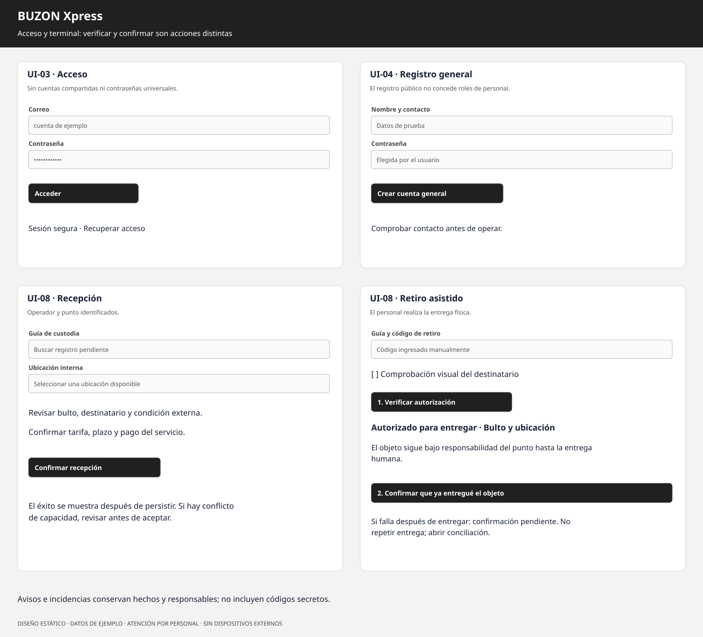

# Galería de wireframes reformulados

Las cinco láminas tienen SVG editable y PNG para insertar en documentos. Son propuestas estáticas con datos ficticios; no son capturas de software implementado. Todos los flujos utilizan atención humana y entrada manual, sin hardware externo.

| Lámina | SVG | PNG |
|---|---|---|
| Portada del servicio | [Editar](landing_page_wireframe.svg) | [Ver](landing_page_wireframe.png) |
| Identidad y compromisos | [Editar](corporate_identity_mockup.svg) | [Ver](corporate_identity_mockup.png) |
| Manifiesto y usos | [Editar](manifesto_grid_mockup.svg) | [Ver](manifesto_grid_mockup.png) |
| Suite de pantallas | [Editar](bw_wireframes_suite.svg) | [Ver](bw_wireframes_suite.png) |
| Acceso y terminal | [Editar](bw_auth_terminal_wireframes.svg) | [Ver](bw_auth_terminal_wireframes.png) |

Los archivos conservan el nombre base de las cinco imágenes del proyecto anterior. La [especificación estructural](../ingenieria/05_wireframes_estructurales_bn.md) explica cada pantalla, sus permisos y sus estados de error. Se regeneran mediante `python herramientas/generar_visuales.py` desde la raíz.
