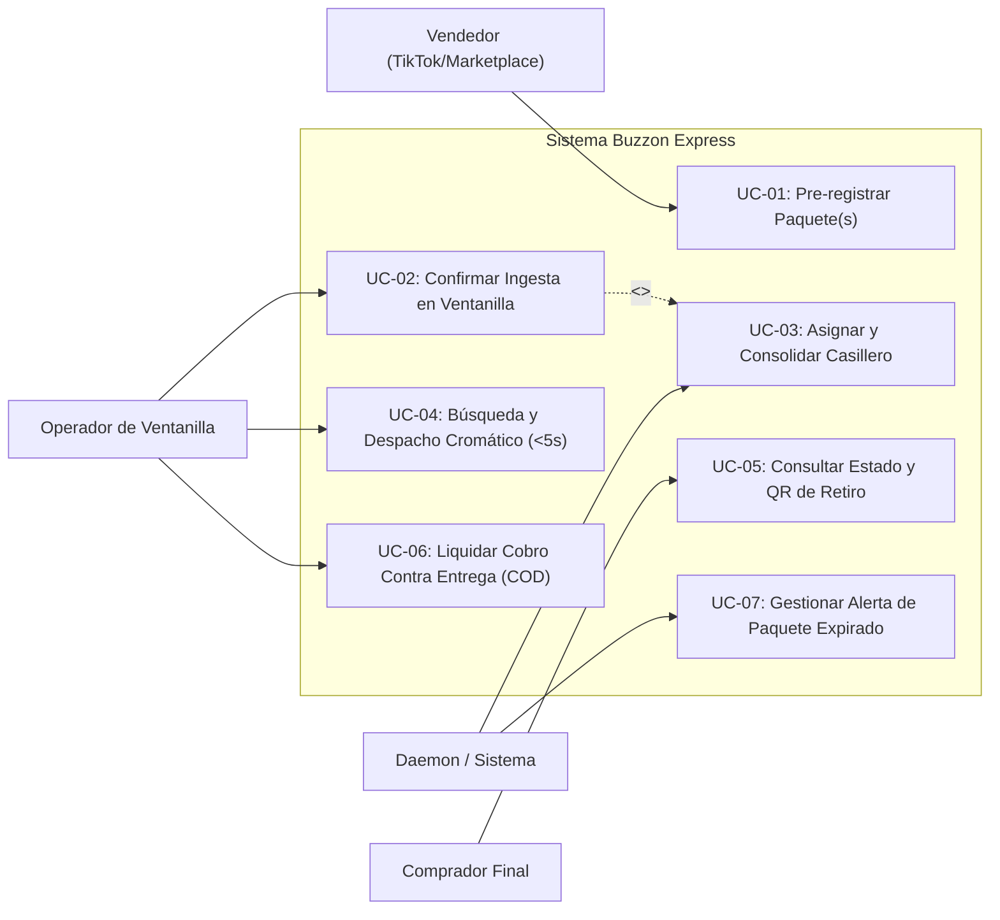
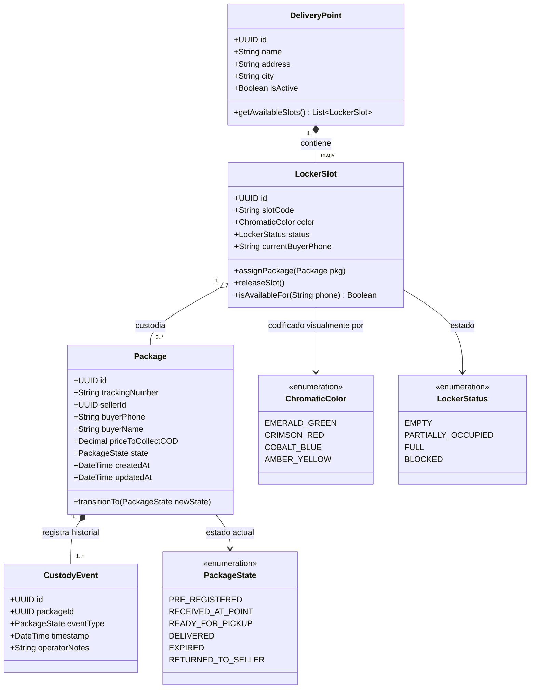
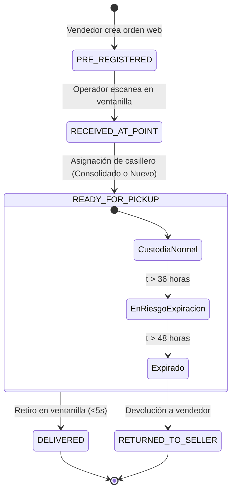
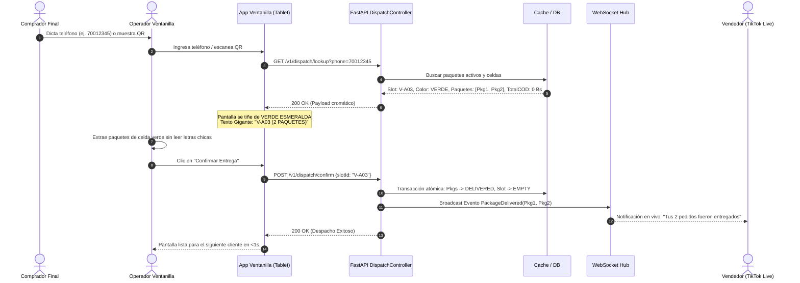
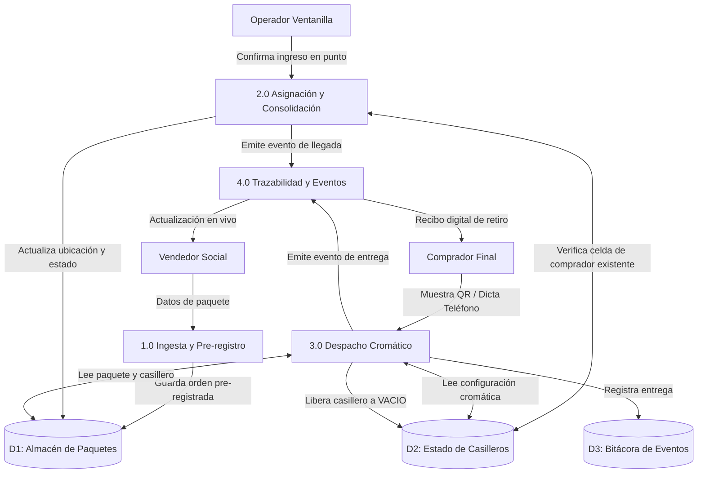

# Modelo de Análisis de Software: Buzzon Express
**Fase de Modelado según Roger S. Pressman (*Ingeniería del Software: Un Enfoque Práctico*)**

---

## 1. Introducción y Principios del Modelado (Pressman)

De acuerdo con Roger S. Pressman, el modelo de análisis debe lograr tres objetivos primordiales:
1. **Describir lo que requiere el cliente.**
2. **Establecer una base para la creación del diseño de software.**
3. **Definir un conjunto de requerimientos que puedan validarse una vez que se construya el software.**

El modelado se estructura en cuatro dimensiones analíticas:
* **Modelado basado en escenarios:** Casos de uso y diagramas de actividades.
* **Modelado basado en clases:** Clases de análisis, diagramas de clases y tarjetas CRC.
* **Modelado del comportamiento:** Diagramas de transición de estados y secuencias de interacción.
* **Modelado orientado al flujo:** Diagramas de Flujo de Datos (DFD Nivel 0 y Nivel 1).

---

## 2. Modelado Basado en Escenarios (Scenario-Based Modeling)

### 2.1. Perfiles de Actores del Sistema
* **Act-01 Vendedor (Emprendedor Social Commerce):** Emite ventas en TikTok Live / WhatsApp. Requiere pre-registrar envíos en segundos sin llenar campos innecesarios.
* **Act-02 Operador de Punto (Ventanilla / Local Aliado):** Atiende físicamente el mostrador. Requiere una interfaz táctil ergonómica y reconocimiento visual inmediato para evitar filas.
* **Act-03 Comprador Final (Cliente):** Recoge los paquetes. Requiere visibilidad sin fricciones técnicas (sin contraseñas complejas) y presentación de credencial digital (QR).
* **Act-04 Sistema / Tareas Asíncronas (Daemon):** Procesa consolidaciones automáticas, caducidad de custodia (>48h) y alertas de estado.

### 2.2. Diagrama de Casos de Uso (UML Use Case)



### 2.3. Especificaciones Formales de Casos de Uso (Plantilla Pressman)

#### Caso de Uso: UC-04 Búsqueda y Despacho Cromático en Ventanilla (<5 seg)
* **Actor Primario:** Operador de Punto (Act-02).
* **Precondiciones:**
  1. El operador ha iniciado sesión en su terminal de punto autorizado.
  2. Uno o más paquetes se encuentran físicamente en estado `LISTO_PARA_RETIRO`.
* **Disparador (Trigger):** El comprador se presenta en la ventanilla y dicta su número de celular o presenta su código QR en pantalla.
* **Flujo Principal (Escenario de Éxito):**
  1. El operador ingresa los dígitos del teléfono o escanea el QR con la cámara del dispositivo.
  2. El sistema consulta en memoria/caché y localiza los registros de custodia asociados en tiempo de respuesta < 150 ms.
  3. El sistema proyecta la pantalla de **Despacho Cromático**: el fondo completo adopta el color del bloque asignado (ej. Verde Esmeralda, Rojo Pasión, Azul Cobalto) y muestra en tipografía gigante el código de celda (ej. `V-A03`) y la cantidad de paquetes (`2 paquetes consolidados`).
  4. El operador visualiza el color, extrae los paquetes correspondientes de la estantería física sin leer etiquetas pequeñas y valida el nombre del destinatario.
  5. Si el paquete requiere Cobro Contra Entrega (COD), el sistema muestra el monto exacto a cobrar en Bs y habilita cobro en efectivo o QR interoperable (Simple).
  6. El operador presiona el botón físico/táctil "Confirmar Entrega".
  7. El sistema transacciona atómicamente el estado de los paquetes a `ENTREGADO`, marca la celda física como `VACIA` y emite eventos de notificación trilateral.
* **Flujos Alternativos:**
  * *4a. Teléfono no registrado o sin paquetes activos:* El sistema emite una señal sonora suave de error y muestra mensaje "Sin paquetes pendientes de retiro para este número".
  * *6a. Pérdida de conexión a internet:* La aplicación del operador conmuta a modo local (IndexedDB), almacena la confirmación con timestamp e id criptográfico, y proyecta la confirmación en pantalla. La sincronización se realiza automáticamente en segundo plano al recuperar enlace.
* **Postcondiciones:** Los paquetes pasan a estado `ENTREGADO`; el casillero queda disponible para una nueva asignación; el vendedor ve actualizada su consola en tiempo real.

---

## 3. Modelado Basado en Clases (Class-Based Modeling)

Pressman clasifica las clases de análisis en: **Límite (Boundary)**, **Control (Control)** y **Entidad (Entity)**.

```
┌─────────────────────────────────────────────────────────────────────────────────────────────────┐
│                           CLASIFICACIÓN DE CLASES DE ANÁLISIS                                   │
├─────────────────────┬─────────────────────────────────────┬─────────────────────────────────────┤
│ Clase de Límite     │ Clase de Control                    │ Clase de Entidad                    │
├─────────────────────┼─────────────────────────────────────┼─────────────────────────────────────┤
│ • PreRegisterView   │ • IngestionController               │ • Package                           │
│ • DispatchView (UX) │ • LockerAllocationController        │ • LockerSlot                        │
│ • TrackingPortalView│ • FastDispatchController            │ • CustodyEvent                      │
│ • QRScannerBoundary │ • NotificationDispatcher            │ • DeliveryPoint                     │
│                     │                                     │ • Seller / BuyerProfile             │
└─────────────────────┴─────────────────────────────────────┴─────────────────────────────────────┘
```

### 3.1. Tarjetas CRC (Class-Responsibility-Collaborator - Ward Cunningham / Pressman)

```
┌─────────────────────────────────────────────────────────────────────────────────────────────────┐
│ Clase: LockerSlot (Entidad)                                                                     │
├───────────────────────────────────────────────────┬─────────────────────────────────────────────┤
│ Responsabilidades:                                │ Colaboradores:                              │
│ 1. Conocer su código alfanumérico y color asignado│ • DeliveryPoint                             │
│ 2. Mantener la lista de paquetes contenidos.      │ • Package                                   │
│ 3. Evaluar su capacidad disponible de volumen.    │ • ChromaticTag (Value Object)               │
│ 4. Permitir u ordenar la consolidación por cliente│                                             │
│ 5. Transicionar estado: Vacio -> Ocupado -> Vacio │                                             │
└───────────────────────────────────────────────────┴─────────────────────────────────────────────┘

┌─────────────────────────────────────────────────────────────────────────────────────────────────┐
│ Clase: FastDispatchController (Control)                                                         │
├───────────────────────────────────────────────────┬─────────────────────────────────────────────┤
│ Responsabilidades:                                │ Colaboradores:                              │
│ 1. Resolver paquetes activos dado un teléfono/QR. │ • PackageRepository                         │
│ 2. Calcular los códigos cromáticos para UI.       │ • LockerSlotRepository                      │
│ 3. Coordinar la entrega atómica multidestino.     │ • CustodyEventLogger                        │
│ 4. Disparar notificaciones a vendedor y comprador.│ • RealtimeNotificationGateway               │
└───────────────────────────────────────────────────┴─────────────────────────────────────────────┘
```

### 3.2. Diagrama de Clases del Dominio



---

## 4. Modelado del Comportamiento (Behavioral Modeling)

### 4.1. Diagrama de Máquina de Estados del Paquete (Pressman Statechart)



### 4.2. Diagrama de Secuencia: Despacho Asistido por Color en Mostrador (<5s)



---

## 5. Modelado Orientado al Flujo (Flow-Oriented Modeling)

### 5.1. DFD Nivel 0 (Diagrama de Contexto de Pressman)

```
                           ┌────────────────────────────────────────────────────────┐
                           │                                                        │
                           │                    SISTEMA CENTRAL                     │
                           │                    BUZZON EXPRESS                      │
                           │                                                        │
                           └───────────────────────────┬────────────────────────────┘
                                                       │
               ┌───────────────────────────────────────┼───────────────────────────────────────┐
               │                                       │                                       │
     Datos de pre-registro                    Lectura QR / Búsqueda                  Consulta estado
               ▲                                       ▲                                       ▲
               │                                       │                                       │
               ▼                                       ▼                                       ▼
    [ ENTIDAD EXTERNA: ]                    [ ENTIDAD EXTERNA: ]                    [ ENTIDAD EXTERNA: ]
    [ Vendedor Social  ]                    [ Operador Punto   ]                    [ Comprador Final  ]
    [ (Emprendedor)    ]                    [ (Ventanilla)     ]                    [ (Destinatario)   ]
```

### 5.2. DFD Nivel 1 (Descomposición en Procesos Principales)


