# Modelo de Datos y Diseño Arquitectónico: BUZON Xpress S.R.L.
**Ingeniería de Datos y Desarrollo Basado en Componentes (CBSE)**
*Marco Teórico y Metodológico: Roger S. Pressman, Eric Evans (DDD), Martin Fowler (PoEAA), Edgar F. Codd & C.J. Date (Modelo Relacional) e Ian Sommerville.*

---

## 1. Fundamentación Epistemológica y Metodológica

El diseño de datos para la plataforma logística **BUZON Xpress S.R.L. Entregas y Almacenamiento** no se concibe como una simple colección de tablas aisladas, sino como el **núcleo transaccional persistente** de una arquitectura orientada a componentes.

### 1.1. Desarrollo Basado en Componentes (CBSE - Roger S. Pressman)
Roger S. Pressman (*Ingeniería del Software: Un Enfoque Práctico*) postula que el Desarrollo Basado en Componentes (CBSE) reduce los costos y tiempos de desarrollo al estructurar el sistema en bloques autónomos, altamente cohesivos y débilmente acoplados. En el diseño a nivel de componentes:
* **Ingeniería del Dominio (Domain Engineering):** Se aíslan los patrones comunes y repetibles de la logística de social commerce boliviana (custodia temporal, consolidación multitienda, despacho cromático asistido, liquidación de cobros contra entrega).
* **Especificación y Cualificación de Componentes:** Cada componente define con precisión su interfaz provista (lo que expone a otros subsistemas) y su interfaz requerida (los datos y servicios que demanda).
* **Mapeo de Persistencia del Componente:** Cada componente del sistema (ej. `LockerAllocationComponent`, `FastDispatchComponent`, `SettlementComponent`) interactúa con esquemas relacionales normalizados que garantizan aislamiento transaccional bajo el estándar ACID.

### 1.2. Diseño Guiado por el Dominio (DDD - Eric Evans)
El modelo de datos refleja el **Lenguaje Ubicuo (Ubiquitous Language)** acordado entre la gerencia operativa y el equipo de ingeniería de BUZON Xpress S.R.L., organizado en Contextos Delimitados (*Bounded Contexts*):
1. **Identity & Access Context:** Gestión de usuarios, roles RBAC, perfiles de vendedores y operadores de sucursal.
2. **Locker Infrastructure Context:** Modelado físico de baterías, casilleros y celdas cromáticas con coordenadas y semáforo de capacidad.
3. **Logistics & Package Context:** Ciclo de vida completo del paquete desde pre-registro web hasta entrega física o devolución.
4. **Multi-Store Consolidation Context:** Agrupación algorítmica de múltiples pedidos destinados al mismo comprador en una única celda física.
5. **Fast POS & Dispatch Context:** Punto de venta de mostrador optimizado para despacho en ventanilla en menos de 5 segundos.
6. **COD & Financial Settlement Context:** Cobranza contra entrega (efectivo y QR interoperable Simple) y liquidaciones masivas a vendedores.
7. **Immutable Audit & Custody Context:** Registro histórico inmutable de eventos de custodia (Event Sourcing / Append-Only).
8. **Offline Resilience Context:** Diario de sincronización bidireccional (Sync Journal) para terminales táctiles en ferias comerciales sin internet continuo.

### 1.3. Patrones de Arquitectura Empresarial (PoEAA - Martin Fowler)
* **Identity Field (UUIDv4):** Claves primarias universales de 128 bits generadas sin colisión, permitiendo que las terminales offline de punto generen transacciones válidas sin conexión previa al servidor central.
* **Optimistic Offline Lock (`version` column):** Control de concurrencia optimista en casilleros y paquetes para prevenir condiciones de carrera cuando múltiples operadores interactúan simultáneamente en horas pico.
* **Append-Only Event Store (`custody_events`):** Registro de auditoría inmutable donde ningún evento físico de manipulación o cambio de estado puede ser modificado o eliminado (cumplimiento regulatorio y trazabilidad civil).

### 1.4. Integridad Relacional y Normalización (Edgar F. Codd & C.J. Date)
El esquema físico satisface la **Tercera Forma Normal (3FN)** y la **Forma Normal de Boyce-Codd (BCNF)**:
* **1FN:** Todos los atributos son atómicos; no existen listas repetitivas dentro de celdas relacionales (los canales sociales y metadatos se tipifican en esquemas relacionales o documentos estructurados validados por constraints).
* **2FN:** No existen dependencias funcionales parciales; cada atributo no clave depende de la totalidad de la clave primaria.
* **3FN / BCNF:** No existen dependencias transitivas; ningún atributo no clave depende de otro atributo no clave. Los cálculos agregados (ej. totales en liquidaciones) se almacenan como instantáneas contables históricas inmutables con reglas de validación en tiempo de inserción.

---

## 2. Diagrama Entidad-Relación Completo (ERD Mermaid)

```mermaid
erDiagram
    DELIVERY_POINTS ||--o{ LOCKER_BANKS : "alberga"
    DELIVERY_POINTS ||--o{ OPERATOR_PROFILES : "emplea en turno"
    DELIVERY_POINTS ||--o{ PACKAGES : "destino de custodia"
    DELIVERY_POINTS ||--o{ CONSOLIDATIONS : "centraliza"
    DELIVERY_POINTS ||--o{ DISPATCH_TRANSACTIONS : "ejecuta en ventanilla"

    LOCKER_BANKS ||--o{ LOCKER_SLOTS : "contiene fisicamente"

    USERS ||--o| SELLER_PROFILES : "extiende perfil vendedor"
    USERS ||--o| OPERATOR_PROFILES : "extiende perfil operador"
    USERS ||--o{ PACKAGES : "vendedor pre-registra"
    USERS ||--o{ DISPATCH_TRANSACTIONS : "operador despacha"
    USERS ||--o{ SELLER_SETTLEMENTS : "liquida fondos"

    LOCKER_SLOTS ||--o{ PACKAGES : "almacena temporalmente"
    LOCKER_SLOTS ||--o{ CONSOLIDATIONS : "reserva para lote"

    PACKAGES ||--o{ CUSTODY_EVENTS : "traza historial inmutable"
    PACKAGES ||--o| CONSOLIDATION_PACKAGES : "incluido en"
    PACKAGES ||--o| COD_COLLECTIONS : "recauda valor"
    PACKAGES ||--o| SETTLEMENT_ITEMS : "liquidado en"

    CONSOLIDATIONS ||--o{ CONSOLIDATION_PACKAGES : "agrupa pedidos"

    DISPATCH_TRANSACTIONS ||--o{ COD_COLLECTIONS : "formaliza cobro"
    DISPATCH_TRANSACTIONS ||--o| POS_SLA_METRICS : "audita tiempo SLA"

    SELLER_SETTLEMENTS ||--o{ SETTLEMENT_ITEMS : "desglosa pagos"

    DELIVERY_POINTS {
        uuid id PK
        string point_code UK "LPZ-01, CBB-01, SCZ-01"
        string name "Casa Matriz La Paz"
        string point_type "SUCURSAL_PROPIA, COMERCIO_ALIADO"
        string city "LA_PAZ, EL_ALTO, COCHABAMBA, SANTA_CRUZ"
        string address "Calle 15, Edif. Logistico"
        string contact_phone "+591 777 00000"
        int total_slots_capacity
        boolean is_active
        timestamp created_at
    }

    LOCKER_BANKS {
        uuid id PK
        uuid delivery_point_id FK
        string bank_code "MOD-A, MOD-B"
        string description "Estanteria Principal Metalica"
        int total_slots
    }

    LOCKER_SLOTS {
        uuid id PK
        uuid locker_bank_id FK
        uuid delivery_point_id FK
        string slot_code UK "V-A01, R-B02, A-C03"
        string color_category "VERDE, ROJO, AZUL, AMARILLO"
        string color_hex "#10B981, #D91438, #0B368C, #F59E0B"
        string size_category "PEQUENO, MEDIANO, GRANDE"
        string status "VACIO, PARCIALMENTE_OCUPADO, LLENO, MANTENIMIENTO"
        string current_buyer_phone "Indexado para consolidacion"
        int max_package_capacity
        int current_package_count
        int version "Control Concurrencia Optimista"
        timestamp last_status_change
    }

    USERS {
        uuid id PK
        string email UK
        string password_hash
        string full_name
        string phone UK
        string role "SUPER_ADMIN, JEFE_SUCURSAL, OPERADOR, VENDEDOR, ALIADO"
        boolean is_active
        timestamp last_login_at
        timestamp created_at
    }

    SELLER_PROFILES {
        uuid user_id PK, FK
        string business_name "Tienda TikTok Bolivia"
        string tax_id "NIT o CI"
        string plan_tier "ESTANDAR, PRO, CORPORATIVO"
        jsonb social_channels "tiktok, instagram, whatsapp"
        jsonb bank_account_info "banco, cuenta, titular"
        decimal commission_rate "0.05 o 0.035"
        string default_origin_city
    }

    OPERATOR_PROFILES {
        uuid user_id PK, FK
        uuid delivery_point_id FK
        string pos_quick_pin_hash "PIN rapido POS"
        string shift_status "EN_TURNO, DESCANSO, FUERA_TURNO"
        timestamp last_shift_start
    }

    PACKAGES {
        uuid id PK
        string tracking_number UK "BX-LPZ-2026-X892"
        string pickup_pin "4918 (4-6 digitos)"
        string qr_security_token UK "Hash HMAC firmado"
        uuid seller_id FK
        uuid origin_point_id FK
        uuid destination_point_id FK
        uuid current_slot_id FK
        string buyer_phone "Indexado B-Tree"
        string buyer_name
        string package_description
        string size_category "PEQUENO, MEDIANO, GRANDE"
        decimal declared_value
        decimal service_fee "5.00 Bs / 3.50 Bs"
        string service_fee_status "PENDIENTE, PAGADO_VENDEDOR, COBRAR_DESTINO"
        decimal cod_amount "Monto Contra Entrega en Bs"
        string cod_status "SIN_COD, PENDIENTE, COBRADO, LIQUIDADO"
        string state "PRE_REGISTRADO, RECIBIDO, EN_CASILLERO, LISTO, ENTREGADO, EXPIRADO, DEVUELTO"
        int version "Optimistic Locking"
        timestamp pre_registered_at
        timestamp received_at
        timestamp stored_at
        timestamp ready_at
        timestamp delivered_at
        timestamp expired_at
    }

    CONSOLIDATIONS {
        uuid id PK
        string consolidation_code UK "CONS-LPZ-70012345-01"
        string buyer_phone "70012345"
        uuid delivery_point_id FK
        uuid slot_id FK
        string status "ABIERTA, LISTA_RETIRO, ENTREGADA, DISUELTA"
        int total_packages_count
        decimal total_cod_amount
        timestamp created_at
        timestamp delivered_at
    }

    CONSOLIDATION_PACKAGES {
        uuid consolidation_id PK, FK
        uuid package_id PK, FK
        timestamp added_at
    }

    DISPATCH_TRANSACTIONS {
        uuid id PK
        string dispatch_code UK "DSP-2026-000891"
        uuid delivery_point_id FK
        uuid operator_id FK
        string buyer_phone
        uuid slot_id FK
        string verification_method "PIN, QR, CI, DIRECTA"
        int total_packages_delivered
        decimal total_cod_collected
        string payment_method "EFECTIVO, QR_SIMPLE, NO_APLICA"
        decimal dispatch_duration_seconds "SLA < 5s"
        uuid offline_sync_id "Si provino de IndexedDB"
        timestamp created_at
    }

    COD_COLLECTIONS {
        uuid id PK
        uuid package_id FK
        uuid dispatch_transaction_id FK
        decimal amount "Bs"
        string payment_method "EFECTIVO, QR_SIMPLE, TRANSFERENCIA"
        string payment_reference "Nro Transaccion QR"
        uuid operator_id FK
        string status "COBRADO, CONCILIADO, LIQUIDADO"
        timestamp created_at
    }

    SELLER_SETTLEMENTS {
        uuid id PK
        string settlement_number UK "LIQ-2026-00045"
        uuid seller_id FK
        date period_start
        date period_end
        int total_packages_count
        decimal gross_cod_collected
        decimal total_service_fees_deducted
        decimal net_payout_amount
        string payout_status "PENDIENTE, EN_PROCESO, PAGADO"
        string payout_method "TRANSFERENCIA_ACH, QR_SIMPLE"
        string payout_reference "Comprobante bancario"
        timestamp paid_at
        timestamp created_at
    }

    SETTLEMENT_ITEMS {
        uuid id PK
        uuid settlement_id FK
        uuid package_id FK
        decimal cod_collected
        decimal fee_applied
        decimal net_item_amount
    }

    CUSTODY_EVENTS {
        uuid id PK
        uuid package_id FK
        string event_type "PRE_REGISTRO, RECEPCION, ASIGNACION, DESPACHO, ENTREGA"
        string previous_state
        string new_state
        uuid delivery_point_id FK
        uuid slot_id FK
        uuid actor_user_id FK
        string actor_role "OPERADOR, VENDEDOR, COMPRADOR, SISTEMA"
        jsonb event_payload
        string ip_address
        timestamp created_at
    }

    POS_SLA_METRICS {
        uuid id PK
        uuid dispatch_transaction_id FK
        uuid delivery_point_id FK
        uuid operator_id FK
        int search_latency_ms "SLA < 150 ms"
        decimal total_handover_seconds "SLA < 5.0 s"
        boolean is_sla_breached
        timestamp created_at
    }

    OFFLINE_SYNC_JOURNAL {
        uuid id PK
        string device_id "Tablet-POS-LPZ-01"
        uuid delivery_point_id FK
        uuid operator_id FK
        string operation_type "INGESTA, ASIGNACION, DESPACHO, COBRO"
        timestamp client_timestamp
        timestamp server_received_at
        jsonb payload_data
        string sync_status "PENDIENTE, APLICADO, CONFLICTO"
        text conflict_notes
    }
```



---

## 3. Diccionario de Datos Relacional Exhaustivo

### 3.1. Dominio: Infraestructura y Sucursales

#### Tabla: `delivery_points` (Puntos de Atención Oficiales y Alianzas)
* **Propósito:** Catálogo de sucursales físicas de BUZON Xpress S.R.L. y locales aliados (red de franquicias/comercios) en el eje troncal y ciudades intermedias de Bolivia.

| Campo | Tipo | Nulo | Restricciones / Valor por Defecto | Descripción de Negocio |
| :--- | :--- | :---: | :--- | :--- |
| `id` | `UUID` | NO | `PRIMARY KEY DEFAULT gen_random_uuid()` | Identificador universal del punto. |
| `point_code` | `VARCHAR(16)` | NO | `UNIQUE NOT NULL` | Código visible (ej. `LPZ-01`, `CBB-01`, `SCZ-01`). |
| `name` | `VARCHAR(100)` | NO | `NOT NULL` | Nombre comercial (ej. `Casa Matriz La Paz`). |
| `point_type` | `VARCHAR(30)` | NO | `CHECK (point_type IN ('SUCURSAL_PROPIA', 'COMERCIO_ALIADO', 'PUNTO_TEMPORAL_FERIA'))` | Modelo operativo del punto. |
| `city` | `VARCHAR(50)` | NO | `CHECK (city IN ('LA_PAZ', 'EL_ALTO', 'COCHABAMBA', 'SANTA_CRUZ', 'SUCRE', 'ORURO', 'TARIJA', 'POTOSI', 'BENI', 'PANDO'))` | Ciudad en territorio boliviano. |
| `zone` | `VARCHAR(80)` | NO | `NOT NULL` | Barrio o macrodistrito (ej. `Zona Sur / San Pedro`, `La Cancha`, `La Ramada`). |
| `address` | `TEXT` | NO | `NOT NULL` | Dirección física detallada. |
| `contact_phone` | `VARCHAR(20)` | NO | `NOT NULL` | Teléfono o celular de contacto oficial. |
| `operating_hours` | `VARCHAR(100)`| NO | `DEFAULT 'Lun a Sáb 08:30 - 20:00 continuo'` | Horario de atención al público. |
| `total_slots_capacity`| `INTEGER` | NO | `CHECK (total_slots_capacity > 0)` | Capacidad total de celdas físicas instaladas. |
| `is_active` | `BOOLEAN` | NO | `DEFAULT TRUE` | Estado administrativo del punto. |
| `created_at` | `TIMESTAMPTZ` | NO | `DEFAULT NOW()` | Fecha y hora de alta en el sistema. |
| `updated_at` | `TIMESTAMPTZ` | NO | `DEFAULT NOW()` | Fecha de última modificación. |

---

#### Tabla: `locker_banks` (Baterías / Módulos de Estantería)
* **Propósito:** Agrupación física de estanterías dentro de una sucursal para ordenar pasillos y módulos ergonómicos.

| Campo | Tipo | Nulo | Restricciones / Valor por Defecto | Descripción de Negocio |
| :--- | :--- | :---: | :--- | :--- |
| `id` | `UUID` | NO | `PRIMARY KEY DEFAULT gen_random_uuid()` | Identificador del módulo. |
| `delivery_point_id` | `UUID` | NO | `FOREIGN KEY REFERENCES delivery_points(id) ON DELETE RESTRICT` | Sucursal a la que pertenece la estantería. |
| `bank_code` | `VARCHAR(16)` | NO | `NOT NULL` | Código físico del estante (ej. `MOD-A`, `MOD-B`). |
| `description` | `VARCHAR(120)`| SÍ | `NULL` | Descripción (ej. `Batería metálica de alta rotación frontal`). |
| `total_slots` | `INTEGER` | NO | `CHECK (total_slots > 0)` | Número de celdas dentro del módulo. |
| `created_at` | `TIMESTAMPTZ` | NO | `DEFAULT NOW()` | Registro de instalación. |

---

#### Tabla: `locker_slots` (Celdas Cromáticas y Casilleros Físicos)
* **Propósito:** Gestión física del casillero, asignación algorítmica de color de alto impacto y control de estado para el despacho < 5s.

| Campo | Tipo | Nulo | Restricciones / Valor por Defecto | Descripción de Negocio |
| :--- | :--- | :---: | :--- | :--- |
| `id` | `UUID` | NO | `PRIMARY KEY DEFAULT gen_random_uuid()` | Identificador de la celda. |
| `locker_bank_id` | `UUID` | NO | `FOREIGN KEY REFERENCES locker_banks(id) ON DELETE RESTRICT` | Módulo contenedor. |
| `delivery_point_id` | `UUID` | NO | `FOREIGN KEY REFERENCES delivery_points(id) ON DELETE RESTRICT` | Sucursal física. |
| `slot_code` | `VARCHAR(16)` | NO | `NOT NULL` | Código visual (ej. `V-A01`, `R-B02`, `A-C03`). |
| `color_category` | `VARCHAR(20)` | NO | `CHECK (color_category IN ('VERDE', 'ROJO', 'AZUL', 'AMARILLO', 'NARANJA', 'MORADO'))` | Color del bloque cromático. |
| `color_hex` | `VARCHAR(7)` | NO | `CHECK (color_hex ~ '^#[0-9A-Fa-f]{6}$')` | Valor HEX oficial (`#10B981`, `#D91438`, `#0B368C`, `#F59E0B`). |
| `size_category` | `VARCHAR(20)` | NO | `CHECK (size_category IN ('PEQUENO', 'MEDIANO', 'GRANDE'))` | Volumen físico de la celda. |
| `status` | `VARCHAR(30)` | NO | `CHECK (status IN ('VACIO', 'PARCIALMENTE_OCUPADO', 'LLENO', 'MANTENIMIENTO')) DEFAULT 'VACIO'` | Estado de disponibilidad en tiempo real. |
| `current_buyer_phone`| `VARCHAR(20)`| SÍ | `NULL` | Teléfono del cliente actualmente asignado (para consolidación automática). |
| `max_package_capacity`| `INTEGER` | NO | `DEFAULT 4 CHECK (max_package_capacity > 0)` | Límite máximo de paquetes pequeños simultáneos. |
| `current_package_count`| `INTEGER` | NO | `DEFAULT 0 CHECK (current_package_count >= 0)` | Paquetes físicamente almacenados actualmente. |
| `version` | `INTEGER` | NO | `DEFAULT 1` | Control de concurrencia optimista (*PoEAA Martin Fowler*). |
| `last_status_change`| `TIMESTAMPTZ`| NO | `DEFAULT NOW()` | Timestamp del último cambio de estado. |

---

### 3.2. Dominio: Usuarios, Roles y Autenticación

#### Tabla: `users` (Cuentas Centrales)
* **Propósito:** Entidad unificada para autenticación con control de acceso basado en roles (RBAC).

| Campo | Tipo | Nulo | Restricciones / Valor por Defecto | Descripción de Negocio |
| :--- | :--- | :---: | :--- | :--- |
| `id` | `UUID` | NO | `PRIMARY KEY DEFAULT gen_random_uuid()` | Identificador del usuario. |
| `email` | `VARCHAR(150)`| NO | `UNIQUE NOT NULL` | Correo electrónico institucional o personal. |
| `password_hash` | `VARCHAR(255)`| NO | `NOT NULL` | Hash criptográfico (Argon2id o Bcrypt). |
| `full_name` | `VARCHAR(150)`| NO | `NOT NULL` | Nombre completo del titular. |
| `phone` | `VARCHAR(20)` | NO | `UNIQUE NOT NULL` | Teléfono móvil (WhatsApp validado). |
| `role` | `VARCHAR(30)` | NO | `CHECK (role IN ('SUPER_ADMIN', 'JEFE_SUCURSAL', 'OPERADOR_VENTANILLA', 'VENDEDOR', 'ALIADO_COMERCIAL'))` | Rol en el sistema. |
| `is_active` | `BOOLEAN` | NO | `DEFAULT TRUE` | Estado de acceso a la plataforma. |
| `is_verified` | `BOOLEAN` | NO | `DEFAULT FALSE` | Verificación de teléfono/correo. |
| `last_login_at` | `TIMESTAMPTZ` | SÍ | `NULL` | Último inicio de sesión. |
| `created_at` | `TIMESTAMPTZ` | NO | `DEFAULT NOW()` | Fecha de registro. |
| `updated_at` | `TIMESTAMPTZ` | NO | `DEFAULT NOW()` | Fecha de actualización. |

---

#### Tabla: `seller_profiles` (Perfil de Vendedor Social Commerce)
* **Propósito:** Datos de negocio, plan tarifario y cuenta bancaria/QR para abono de cobros contra entrega (COD).

| Campo | Tipo | Nulo | Restricciones / Valor por Defecto | Descripción de Negocio |
| :--- | :--- | :---: | :--- | :--- |
| `user_id` | `UUID` | NO | `PRIMARY KEY REFERENCES users(id) ON DELETE CASCADE` | Llave primaria foránea 1:1 con `users`. |
| `business_name` | `VARCHAR(150)`| NO | `NOT NULL` | Nombre de la tienda o marca (ej. `Moda Bolivia Live`). |
| `tax_id` | `VARCHAR(30)` | SÍ | `NULL` | NIT o CI del emprendedor. |
| `plan_tier` | `VARCHAR(20)` | NO | `CHECK (plan_tier IN ('ESTANDAR', 'PRO', 'CORPORATIVO')) DEFAULT 'ESTANDAR'` | Plan de comisiones contratado. |
| `commission_rate`| `NUMERIC(4,3)`| NO | `DEFAULT 0.050` | Comisión porcentual por cobro COD (5% estándar, 3.5% Pro). |
| `social_channels`| `JSONB` | NO | `DEFAULT '{}'::jsonb` | URLs: `{"tiktok": "...", "instagram": "...", "whatsapp": "..."}`. |
| `bank_account_info`| `JSONB` | NO | `DEFAULT '{}'::jsonb` | Datos bancarios: `{"bank": "BISA", "account_number": "...", "holder": "..."}`. |
| `qr_simple_url` | `TEXT` | SÍ | `NULL` | URL de la imagen del QR Simple del vendedor para pagos directos. |
| `default_origin_city`| `VARCHAR(50)`| NO | `DEFAULT 'LA_PAZ'` | Ciudad principal de despacho de mercadería. |
| `rating_score` | `NUMERIC(3,2)`| NO | `DEFAULT 5.00` | Calificación histórica de cumplimiento de entregas. |

---

#### Tabla: `operator_profiles` (Perfil de Operador de Mostrador)
* **Propósito:** Control de turno y acceso táctil rápido en la terminal de ventanilla.

| Campo | Tipo | Nulo | Restricciones / Valor por Defecto | Descripción de Negocio |
| :--- | :--- | :---: | :--- | :--- |
| `user_id` | `UUID` | NO | `PRIMARY KEY REFERENCES users(id) ON DELETE CASCADE` | Llave foránea 1:1 con `users`. |
| `delivery_point_id` | `UUID` | NO | `FOREIGN KEY REFERENCES delivery_points(id) ON DELETE RESTRICT` | Sucursal fija asignada. |
| `pos_quick_pin_hash`| `VARCHAR(255)`| NO | `NOT NULL` | Hash de PIN de 4 dígitos para desbloqueo ágil de la tablet. |
| `shift_status` | `VARCHAR(20)` | NO | `CHECK (shift_status IN ('EN_TURNO', 'DESCANSO', 'FUERA_TURNO')) DEFAULT 'FUERA_TURNO'` | Estado laboral en el terminal. |
| `last_shift_start` | `TIMESTAMPTZ` | SÍ | `NULL` | Hora de apertura de turno de caja. |

---

### 3.3. Dominio: Paquetes y Logística Central

#### Tabla: `packages` (El Agregado Central de Paquetes)
* **Propósito:** Registro central de cada paquete individual, su custodia, ubicación cromática y cobros asociados.

| Campo | Tipo | Nulo | Restricciones / Valor por Defecto | Descripción de Negocio |
| :--- | :--- | :---: | :--- | :--- |
| `id` | `UUID` | NO | `PRIMARY KEY DEFAULT gen_random_uuid()` | Identificador universal inmutable. |
| `tracking_number` | `VARCHAR(32)` | NO | `UNIQUE NOT NULL` | Código visible de rastreo (ej. `BX-LPZ-2026-X892`). |
| `pickup_pin` | `VARCHAR(6)` | NO | `NOT NULL` | PIN numérico secreto para retiro en ventanilla (ej. `4918`). |
| `qr_security_token`| `VARCHAR(64)`| NO | `UNIQUE NOT NULL` | Token criptográfico para generación de QR de retiro. |
| `seller_id` | `UUID` | NO | `FOREIGN KEY REFERENCES users(id) ON DELETE RESTRICT` | Vendedor emisor del paquete. |
| `origin_point_id` | `UUID` | NO | `FOREIGN KEY REFERENCES delivery_points(id) ON DELETE RESTRICT` | Sucursal donde se entregó inicialmente. |
| `destination_point_id`| `UUID` | NO | `FOREIGN KEY REFERENCES delivery_points(id) ON DELETE RESTRICT` | Sucursal donde el comprador retirará. |
| `current_slot_id` | `UUID` | SÍ | `FOREIGN KEY REFERENCES locker_slots(id) ON DELETE SET NULL` | Casillero físico donde descansa actualmente. |
| `consolidation_id`| `UUID` | SÍ | `NULL` | FK opcional si forma parte de un lote multitienda. |
| `buyer_phone` | `VARCHAR(20)` | NO | `NOT NULL` | Celular del comprador (Llave de búsqueda primaria indexada). |
| `buyer_name` | `VARCHAR(120)`| NO | `NOT NULL` | Nombre completo del comprador o destinatario. |
| `buyer_notes` | `TEXT` | SÍ | `NULL` | Instrucciones de entrega o referencias del cliente. |
| `package_description`| `VARCHAR(255)`| NO | `NOT NULL` | Descripción del contenido (ej. `Vestido Fiesta Rojo Talla M`). |
| `size_category` | `VARCHAR(20)` | NO | `CHECK (size_category IN ('PEQUENO', 'MEDIANO', 'GRANDE')) DEFAULT 'PEQUENO'` | Categoría física volumétrica. |
| `declared_value` | `NUMERIC(10,2)`| NO | `DEFAULT 0.00 CHECK (declared_value >= 0)` | Valor declarado de la mercadería en Bs. |
| `service_fee` | `NUMERIC(10,2)`| NO | `DEFAULT 5.00 CHECK (service_fee >= 0)` | Costo del servicio de custodia y despacho (5 Bs / 3.50 Bs). |
| `service_fee_status`| `VARCHAR(25)` | NO | `CHECK (service_fee_status IN ('PENDIENTE', 'PAGADO_POR_VENDEDOR', 'COBRAR_A_DESTINO')) DEFAULT 'PENDIENTE'` | Modalidad de cobro del costo de envío. |
| `cod_amount` | `NUMERIC(10,2)`| NO | `DEFAULT 0.00 CHECK (cod_amount >= 0)` | Monto a cobrar al cliente final por el producto (COD). |
| `cod_status` | `VARCHAR(25)` | NO | `CHECK (cod_status IN ('SIN_COD', 'PENDIENTE_COBRO', 'COBRADO_EN_VENTANILLA', 'LIQUIDADO_A_VENDEDOR')) DEFAULT 'SIN_COD'` | Estado del dinero del producto. |
| `state` | `VARCHAR(35)` | NO | `CHECK (state IN ('PRE_REGISTRADO', 'EN_TRANSITO_INTERDEPARTAMENTAL', 'RECIBIDO_EN_SUCURSAL', 'UBICADO_EN_CASILLERO', 'LISTO_PARA_RETIRO', 'ENTREGADO', 'EXPIRADO', 'DEVUELTO_A_VENDEDOR', 'CANCELADO')) DEFAULT 'PRE_REGISTRADO'` | Máquina de estados del paquete (*Pressman Statechart*). |
| `version` | `INTEGER` | NO | `DEFAULT 1` | Control de concurrencia optimista. |
| `pre_registered_at`| `TIMESTAMPTZ`| NO | `DEFAULT NOW()` | Fecha y hora de creación de la orden web. |
| `received_at` | `TIMESTAMPTZ` | SÍ | `NULL` | Fecha y hora de recepción física en mostrador. |
| `stored_at` | `TIMESTAMPTZ` | SÍ | `NULL` | Fecha de colocación en celda física. |
| `ready_for_pickup_at`|`TIMESTAMPTZ`| SÍ | `NULL` | Fecha de activación de notificación de retiro al comprador. |
| `delivered_at` | `TIMESTAMPTZ` | SÍ | `NULL` | Fecha de entrega física comprobada en ventanilla. |
| `expired_at` | `TIMESTAMPTZ` | SÍ | `NULL` | Fecha en que superó el tiempo máximo de custodia (>48-72h). |
| `returned_at` | `TIMESTAMPTZ` | SÍ | `NULL` | Fecha de devolución al vendedor emisor. |
| `created_at` | `TIMESTAMPTZ` | NO | `DEFAULT NOW()` | Creación de registro. |
| `updated_at` | `TIMESTAMPTZ` | NO | `DEFAULT NOW()` | Última actualización. |

---

### 3.4. Dominio: Consolidación Multitienda

#### Tabla: `consolidations` (Lote de Pedidos Agrupados)
* **Propósito:** Agrupar compras de diferentes vendedores dirigidas al mismo comprador en una sola celda física, ahorrando espacio y tiempo de entrega.

| Campo | Tipo | Nulo | Restricciones / Valor por Defecto | Descripción de Negocio |
| :--- | :--- | :---: | :--- | :--- |
| `id` | `UUID` | NO | `PRIMARY KEY DEFAULT gen_random_uuid()` | Identificador del lote consolidado. |
| `consolidation_code`| `VARCHAR(32)`| NO | `UNIQUE NOT NULL` | Código único de consolidación (ej. `CONS-LPZ-70012345-01`). |
| `buyer_phone` | `VARCHAR(20)` | NO | `NOT NULL` | Teléfono del destinatario común. |
| `delivery_point_id` | `UUID` | NO | `FOREIGN KEY REFERENCES delivery_points(id) ON DELETE RESTRICT` | Sucursal donde se concentra el retiro. |
| `slot_id` | `UUID` | NO | `FOREIGN KEY REFERENCES locker_slots(id) ON DELETE RESTRICT` | Celda compartida asignada. |
| `status` | `VARCHAR(25)` | NO | `CHECK (status IN ('ABIERTA', 'LISTA_PARA_RETIRO', 'ENTREGADA_COMPLETA', 'DISUELTA')) DEFAULT 'ABIERTA'` | Estado del lote. |
| `total_packages_count`| `INTEGER` | NO | `DEFAULT 0 CHECK (total_packages_count >= 0)` | Número de paquetes agrupados. |
| `total_cod_amount` | `NUMERIC(10,2)`| NO | `DEFAULT 0.00 CHECK (total_cod_amount >= 0)` | Suma total de pagos COD pendientes de cobro. |
| `created_at` | `TIMESTAMPTZ` | NO | `DEFAULT NOW()` | Fecha de apertura de la consolidación. |
| `completed_at` | `TIMESTAMPTZ` | SÍ | `NULL` | Fecha de cierre del lote. |
| `delivered_at` | `TIMESTAMPTZ` | SÍ | `NULL` | Fecha de retiro conjunto por el cliente. |

---

#### Tabla: `consolidation_packages` (Relación M:N Paquete - Consolidación)
* **Propósito:** Tabla asociativa normalizada que vincula cada paquete individual con su lote de consolidación.

| Campo | Tipo | Nulo | Restricciones / Valor por Defecto | Descripción de Negocio |
| :--- | :--- | :---: | :--- | :--- |
| `consolidation_id` | `UUID` | NO | `FOREIGN KEY REFERENCES consolidations(id) ON DELETE CASCADE` | Lote de consolidación. |
| `package_id` | `UUID` | NO | `UNIQUE FOREIGN KEY REFERENCES packages(id) ON DELETE CASCADE` | Paquete contenido (un paquete solo pertenece a una consolidación activa). |
| `added_at` | `TIMESTAMPTZ` | NO | `DEFAULT NOW()` | Timestamp en que se insertó físicamente al casillero. |

---

### 3.5. Dominio: Despacho en Ventanilla y Punto de Venta (POS)

#### Tabla: `dispatch_transactions` (Comprobante de Despacho < 5s)
* **Propósito:** Registro atómico de la operación de entrega en mostrador con validación biométrica/PIN/QR y medición de tiempos de servicio.

| Campo | Tipo | Nulo | Restricciones / Valor por Defecto | Descripción de Negocio |
| :--- | :--- | :---: | :--- | :--- |
| `id` | `UUID` | NO | `PRIMARY KEY DEFAULT gen_random_uuid()` | Identificador de la transacción. |
| `dispatch_code` | `VARCHAR(32)` | NO | `UNIQUE NOT NULL` | Número de comprobante físico/digital (ej. `DSP-2026-000891`). |
| `delivery_point_id` | `UUID` | NO | `FOREIGN KEY REFERENCES delivery_points(id) ON DELETE RESTRICT` | Sucursal donde ocurrió el despacho. |
| `operator_id` | `UUID` | NO | `FOREIGN KEY REFERENCES users(id) ON DELETE RESTRICT` | Operador que atendió la ventanilla. |
| `buyer_phone` | `VARCHAR(20)` | NO | `NOT NULL` | Teléfono del cliente atendido. |
| `slot_id` | `UUID` | NO | `FOREIGN KEY REFERENCES locker_slots(id) ON DELETE RESTRICT` | Celda liberada en la entrega. |
| `verification_method`| `VARCHAR(30)` | NO | `CHECK (verification_method IN ('PIN_NUMERICO', 'QR_DINAMICO', 'DOCUMENTO_CI', 'VERIFICACION_DIRECTA'))` | Método usado para comprobar identidad. |
| `total_packages_delivered`| `INTEGER`| NO | `CHECK (total_packages_delivered > 0)` | Cantidad de paquetes entregados en la transacción. |
| `total_cod_collected`| `NUMERIC(10,2)`| NO | `DEFAULT 0.00 CHECK (total_cod_collected >= 0)` | Monto total recaudado por Cobro Contra Entrega en Bs. |
| `payment_method` | `VARCHAR(30)` | NO | `CHECK (payment_method IN ('EFECTIVO', 'QR_SIMPLE_INTEROPERABLE', 'TRANSFERENCIA', 'NO_APLICA')) DEFAULT 'NO_APLICA'` | Medio de pago utilizado por el comprador. |
| `dispatch_duration_seconds`| `NUMERIC(5,2)`| SÍ| `CHECK (dispatch_duration_seconds >= 0)` | Tiempo transcurrido desde la búsqueda hasta la confirmación (auditoría SLA < 5s). |
| `offline_sync_id` | `UUID` | SÍ | `NULL` | Referencia al diario de sincronización si se procesó offline. |
| `created_at` | `TIMESTAMPTZ` | NO | `DEFAULT NOW()` | Timestamp exacto de la entrega física. |

---

#### Tabla: `cod_collections` (Recaudaciones por Cobro Contra Entrega)
* **Propósito:** Conciliación monetaria individual de cada cobro efectuado en ventanilla a favor del vendedor.

| Campo | Tipo | Nulo | Restricciones / Valor por Defecto | Descripción de Negocio |
| :--- | :--- | :---: | :--- | :--- |
| `id` | `UUID` | NO | `PRIMARY KEY DEFAULT gen_random_uuid()` | Identificador del cobro. |
| `package_id` | `UUID` | NO | `FOREIGN KEY REFERENCES packages(id) ON DELETE RESTRICT` | Paquete cuyo producto fue cobrado. |
| `dispatch_transaction_id`|`UUID`| NO | `FOREIGN KEY REFERENCES dispatch_transactions(id) ON DELETE CASCADE`| Transacción de ventanilla que recaudó el dinero. |
| `amount` | `NUMERIC(10,2)`| NO | `CHECK (amount > 0)` | Monto recaudado en Bolivianos (Bs). |
| `payment_method` | `VARCHAR(30)` | NO | `CHECK (payment_method IN ('EFECTIVO', 'QR_SIMPLE_INTEROPERABLE', 'TRANSFERENCIA_BANCARIA'))`| Método de cobro recibido. |
| `payment_reference`| `VARCHAR(100)`| SÍ | `NULL` | Código de autorización o nro de transacción bancaria. |
| `operator_id` | `UUID` | NO | `FOREIGN KEY REFERENCES users(id) ON DELETE RESTRICT` | Operador custodio del dinero. |
| `status` | `VARCHAR(25)` | NO | `CHECK (status IN ('COBRADO', 'CONCILIADO_EN_CAJA', 'LIQUIDADO_A_VENDEDOR', 'ANULADO')) DEFAULT 'COBRADO'` | Estado financiero del fondo recaudado. |
| `created_at` | `TIMESTAMPTZ` | NO | `DEFAULT NOW()` | Fecha y hora de recepción del dinero. |

---

### 3.6. Dominio: Liquidaciones y Finanzas para Vendedores

#### Tabla: `seller_settlements` (Liquidaciones Periódicas a Emprendedores)
* **Propósito:** Agrupación y liquidación contable de los fondos recaudados por COD menos las tarifas de servicio de BUZON Xpress S.R.L.

| Campo | Tipo | Nulo | Restricciones / Valor por Defecto | Descripción de Negocio |
| :--- | :--- | :---: | :--- | :--- |
| `id` | `UUID` | NO | `PRIMARY KEY DEFAULT gen_random_uuid()` | Identificador de la liquidación. |
| `settlement_number`| `VARCHAR(32)`| NO | `UNIQUE NOT NULL` | Código visible (ej. `LIQ-2026-00045`). |
| `seller_id` | `UUID` | NO | `FOREIGN KEY REFERENCES users(id) ON DELETE RESTRICT` | Vendedor beneficiario de los fondos. |
| `period_start` | `DATE` | NO | `NOT NULL` | Fecha de inicio del periodo liquidado. |
| `period_end` | `DATE` | NO | `NOT NULL` | Fecha de cierre del periodo liquidado. |
| `total_packages_count`| `INTEGER`| NO | `CHECK (total_packages_count > 0)` | Cantidad de paquetes incluidos en la liquidación. |
| `gross_cod_collected`| `NUMERIC(12,2)`| NO | `CHECK (gross_cod_collected >= 0)` | Total bruto recaudado por ventas COD en ventanilla. |
| `total_service_fees_deducted`|`NUMERIC(12,2)`| NO | `CHECK (total_service_fees_deducted >= 0)` | Descuento total por tarifas de custodia y despacho BUZON Xpress. |
| `net_payout_amount` | `NUMERIC(12,2)`| NO | `CHECK (net_payout_amount >= 0)` | Monto neto a pagar al vendedor (`gross - fees`). |
| `payout_status` | `VARCHAR(25)` | NO | `CHECK (payout_status IN ('PENDIENTE', 'EN_PROCESO', 'PAGADO', 'RECHAZADO')) DEFAULT 'PENDIENTE'` | Estado de la transferencia. |
| `payout_method` | `VARCHAR(30)` | NO | `CHECK (payout_method IN ('TRANSFERENCIA_ACH', 'QR_SIMPLE_PAGO', 'EFECTIVO_EN_SUCURSAL'))` | Vía utilizada para el abono. |
| `payout_reference` | `VARCHAR(100)`| SÍ | `NULL` | Comprobante de transferencia bancaria emitida. |
| `paid_at` | `TIMESTAMPTZ` | SÍ | `NULL` | Timestamp de confirmación bancaria. |
| `created_at` | `TIMESTAMPTZ` | NO | `DEFAULT NOW()` | Fecha de generación del corte contable. |

---

#### Tabla: `settlement_items` (Desglose por Paquete en la Liquidación)
* **Propósito:** Detalle línea por línea de cada paquete liquidado con su comisión aplicada.

| Campo | Tipo | Nulo | Restricciones / Valor por Defecto | Descripción de Negocio |
| :--- | :--- | :---: | :--- | :--- |
| `id` | `UUID` | NO | `PRIMARY KEY DEFAULT gen_random_uuid()` | Identificador de línea. |
| `settlement_id` | `UUID` | NO | `FOREIGN KEY REFERENCES seller_settlements(id) ON DELETE CASCADE` | Cabecera de la liquidación. |
| `package_id` | `UUID` | NO | `UNIQUE FOREIGN KEY REFERENCES packages(id) ON DELETE RESTRICT` | Paquete individual liquidado. |
| `cod_collected` | `NUMERIC(10,2)`| NO | `CHECK (cod_collected >= 0)` | Monto cobrado al comprador. |
| `fee_applied` | `NUMERIC(10,2)`| NO | `CHECK (fee_applied >= 0)` | Tarifa cobrada por BUZON Xpress. |
| `net_item_amount` | `NUMERIC(10,2)`| NO | `CHECK (net_item_amount >= 0)` | Saldo neto atribuido al vendedor por este paquete. |

---

### 3.7. Dominio: Auditoría Inmutable (Event Sourcing)

#### Tabla: `custody_events` (Bitácora Histórica Inmutable)
* **Propósito:** Registro *append-only* que almacena de forma inalterable cada transición de estado, escaneo y movimiento físico de un paquete. Cumple con los estándares de no repudio y auditoría legal.

| Campo | Tipo | Nulo | Restricciones / Valor por Defecto | Descripción de Negocio |
| :--- | :--- | :---: | :--- | :--- |
| `id` | `UUID` | NO | `PRIMARY KEY DEFAULT gen_random_uuid()` | Identificador del evento. |
| `package_id` | `UUID` | NO | `FOREIGN KEY REFERENCES packages(id) ON DELETE RESTRICT` | Paquete afectado. |
| `event_type` | `VARCHAR(40)` | NO | `NOT NULL` | Código de evento (`PRE_REGISTRO`, `RECEPCION_PUNTO`, `ASIGNACION_CELDA`, `CONSOLIDACION`, `DESPACHO`, `ENTREGA`, `EXPIRACION`, `DEVOLUCION`). |
| `previous_state` | `VARCHAR(35)` | SÍ | `NULL` | Estado antes del evento. |
| `new_state` | `VARCHAR(35)` | NO | `NOT NULL` | Estado posterior al evento. |
| `delivery_point_id` | `UUID` | SÍ | `FOREIGN KEY REFERENCES delivery_points(id) ON DELETE SET NULL` | Sucursal donde ocurrió el evento. |
| `slot_id` | `UUID` | SÍ | `FOREIGN KEY REFERENCES locker_slots(id) ON DELETE SET NULL` | Celda física involucrada (si aplica). |
| `actor_user_id` | `UUID` | SÍ | `FOREIGN KEY REFERENCES users(id) ON DELETE SET NULL` | Usuario que ejecutó la acción. |
| `actor_role` | `VARCHAR(30)` | NO | `NOT NULL` | Rol operativo (`OPERADOR`, `VENDEDOR`, `COMPRADOR`, `SISTEMA`). |
| `event_payload` | `JSONB` | NO | `DEFAULT '{}'::jsonb` | Metadatos enriquecidos del evento. |
| `ip_address` | `VARCHAR(45)` | SÍ | `NULL` | Dirección IP del cliente/terminal. |
| `user_agent` | `TEXT` | SÍ | `NULL` | Dispositivo o navegador utilizado. |
| `created_at` | `TIMESTAMPTZ` | NO | `DEFAULT NOW()` | Fecha y hora inmutable del evento (*Append-Only*). |

---

### 3.8. Dominio: Resiliencia Offline y Calidad Operativa (SLA)

#### Tabla: `offline_sync_journal` (Diario de Sincronización para Ferias)
* **Propósito:** Almacenar transacciones creadas en modo desconectado (IndexedDB en tablets de mostrador) para su conciliación asíncrona al retornar la conexión a internet.

| Campo | Tipo | Nulo | Restricciones / Valor por Defecto | Descripción de Negocio |
| :--- | :--- | :---: | :--- | :--- |
| `id` | `UUID` | NO | `PRIMARY KEY` | UUID generado localmente en la tablet del operador. |
| `device_id` | `VARCHAR(64)` | NO | `NOT NULL` | Identificador de hardware de la tablet o lector móvil. |
| `delivery_point_id` | `UUID` | NO | `FOREIGN KEY REFERENCES delivery_points(id) ON DELETE RESTRICT` | Sucursal donde se operó sin internet. |
| `operator_id` | `UUID` | NO | `FOREIGN KEY REFERENCES users(id) ON DELETE RESTRICT` | Operador que despachó offline. |
| `operation_type` | `VARCHAR(30)` | NO | `CHECK (operation_type IN ('INGESTA_RECEPCION', 'ASIGNACION_CELDA', 'DESPACHO_VENTANILLA', 'COBRO_COD'))` | Tipo de operación offline. |
| `client_timestamp` | `TIMESTAMPTZ` | NO | `NOT NULL` | Hora local exacta del dispositivo al ocurrir la acción. |
| `server_received_at`| `TIMESTAMPTZ`| NO | `DEFAULT NOW()` | Hora en que el servidor recibió el paquete de sincronización. |
| `payload_data` | `JSONB` | NO | `NOT NULL` | Carga completa de la transacción a replicar. |
| `sync_status` | `VARCHAR(25)` | NO | `CHECK (sync_status IN ('PENDIENTE', 'APLICADO', 'CONFLICTO_RESUELTO', 'RECHAZADO')) DEFAULT 'PENDIENTE'` | Estado de procesamiento en el backend central. |
| `conflict_notes` | `TEXT` | SÍ | `NULL` | Detalle de discrepancias resueltas (ej. duplicidad de escaneo). |

---

#### Tabla: `pos_sla_metrics` (Monitoreo de Desempeño en Ventanilla)
* **Propósito:** Registro automático de latencia para certificar el cumplimiento de la política institucional de **Cero Filas (< 5 segundos de despacho)**.

| Campo | Tipo | Nulo | Restricciones / Valor por Defecto | Descripción de Negocio |
| :--- | :--- | :---: | :--- | :--- |
| `id` | `UUID` | NO | `PRIMARY KEY DEFAULT gen_random_uuid()` | Identificador de la métrica. |
| `dispatch_transaction_id`|`UUID`| NO | `UNIQUE FOREIGN KEY REFERENCES dispatch_transactions(id) ON DELETE CASCADE`| Despacho evaluado. |
| `delivery_point_id` | `UUID` | NO | `FOREIGN KEY REFERENCES delivery_points(id) ON DELETE RESTRICT` | Punto de atención. |
| `operator_id` | `UUID` | NO | `FOREIGN KEY REFERENCES users(id) ON DELETE RESTRICT` | Operador medido. |
| `search_latency_ms` | `INTEGER` | NO | `CHECK (search_latency_ms >= 0)` | Latencia de búsqueda (< 150 ms según RF05). |
| `total_handover_seconds`| `NUMERIC(5,2)`| NO | `CHECK (total_handover_seconds >= 0)` | Tiempo total de atención en mostrador (SLA < 5.0 s). |
| `is_sla_breached` | `BOOLEAN` | NO | `DEFAULT FALSE` | `TRUE` si el tiempo total superó los 5.0 segundos. |
| `created_at` | `TIMESTAMPTZ` | NO | `DEFAULT NOW()` | Timestamp de registro. |

---

## 4. Estrategia de Indexación para Búsqueda < 150 ms (RP01)

Para garantizar que el operador de ventanilla obtenga la pantalla cromática al instante al digitar el número de celular del comprador o escanear el código QR, se implementa una estrategia de indexación B-Tree especializada y selectiva en PostgreSQL:

```sql
-- 1. Búsqueda primaria de paquetes listos para retiro en ventanilla por celular
-- Índice parcial que excluye paquetes ya entregados o cancelados (minimiza tamaño en RAM)
CREATE INDEX idx_packages_active_pickup_by_phone 
ON packages (buyer_phone, destination_point_id) 
WHERE state IN ('UBICADO_EN_CASILLERO', 'LISTO_PARA_RETIRO');

-- 2. Búsqueda instantánea por PIN numérico de seguridad
CREATE INDEX idx_packages_pickup_pin_lookup 
ON packages (destination_point_id, pickup_pin) 
WHERE state = 'LISTO_PARA_RETIRO';

-- 3. Búsqueda por token criptográfico QR de alta velocidad
CREATE UNIQUE INDEX idx_packages_qr_token_exact 
ON packages (qr_security_token);

-- 4. Índice para el algoritmo de consolidación multitienda:
-- Permite saber en < 10 ms si un casillero ya contiene paquetes del mismo comprador en ese punto
CREATE INDEX idx_locker_slots_buyer_consolidation 
ON locker_slots (delivery_point_id, current_buyer_phone) 
WHERE status IN ('PARCIALMENTE_OCUPADO', 'LLENO');

-- 5. Consulta en tiempo real de disponibilidad física de casilleros por color y tamaño
CREATE INDEX idx_locker_slots_availability 
ON locker_slots (delivery_point_id, size_category, status) 
WHERE status = 'VACIO';

-- 6. Auditoría inmutable y reconstrucción de trazabilidad por paquete
CREATE INDEX idx_custody_events_timeline 
ON custody_events (package_id, created_at ASC);
```

---

## 5. Control de Concurrencia Optimista y Triggers Automáticos

### 5.1. Concurrencia Optimista (Martin Fowler PoEAA)
En horas pico (ej. después de transmisiones de TikTok Live donde 50 compradores acuden simultáneamente a retirar a la misma sucursal), múltiples operadores podrían intentar asignar o despachar la misma celda física.
El campo `version` en `locker_slots` y `packages` previene sobrescrituras accidentales mediante sentencias atómicas:

```sql
UPDATE locker_slots 
SET status = 'VACIO', 
    current_buyer_phone = NULL, 
    current_package_count = 0,
    version = version + 1,
    last_status_change = NOW()
WHERE id = $1 AND version = $2;
-- Si rows_affected == 0, el sistema detecta colisión y reintenta de forma transparente.
```

### 5.2. Trigger de Integridad para Trazabilidad Inmutable
Cada vez que un paquete experimenta un cambio en su columna `state`, un trigger en PostgreSQL inserta automáticamente el registro correspondiente en `custody_events`:

```sql
CREATE OR REPLACE FUNCTION fn_audit_package_state_change()
RETURNS TRIGGER AS $$
BEGIN
    IF (OLD.state IS DISTINCT FROM NEW.state) THEN
        INSERT INTO custody_events (
            package_id,
            event_type,
            previous_state,
            new_state,
            delivery_point_id,
            slot_id,
            actor_role,
            event_payload,
            created_at
        ) VALUES (
            NEW.id,
            CONCAT('TRANSICION_', NEW.state),
            OLD.state,
            NEW.state,
            NEW.destination_point_id,
            NEW.current_slot_id,
            'SISTEMA',
            jsonb_build_object(
                'trigger_reason', 'Automatic state machine transition',
                'tracking_number', NEW.tracking_number,
                'buyer_phone', NEW.buyer_phone
            ),
            NOW()
        );
    END IF;
    NEW.updated_at = NOW();
    RETURN NEW;
END;
$$ LANGUAGE plpgsql;

CREATE TRIGGER trg_audit_package_state
BEFORE UPDATE ON packages
FOR EACH ROW
EXECUTE FUNCTION fn_audit_package_state_change();
```
