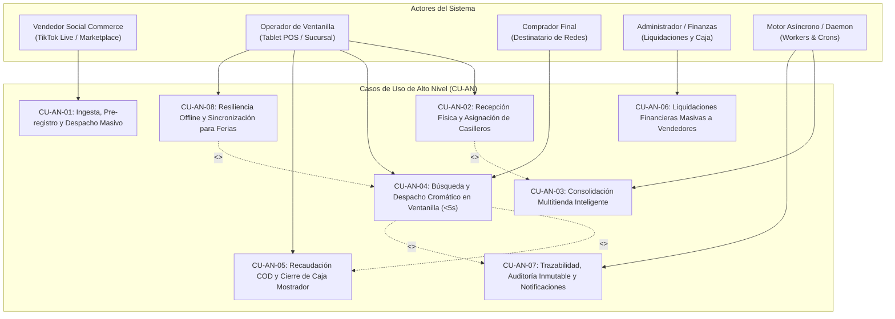
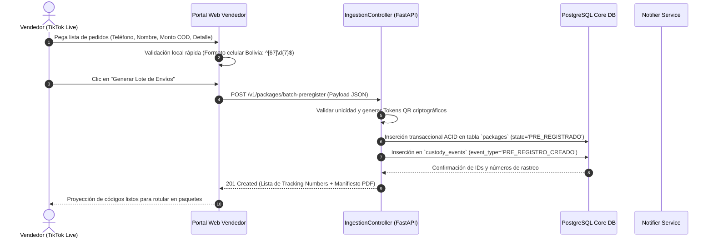
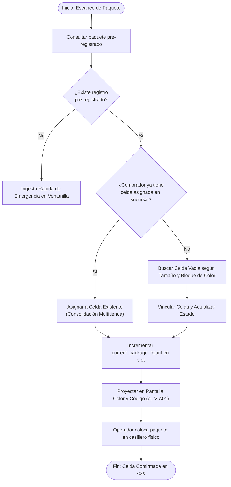
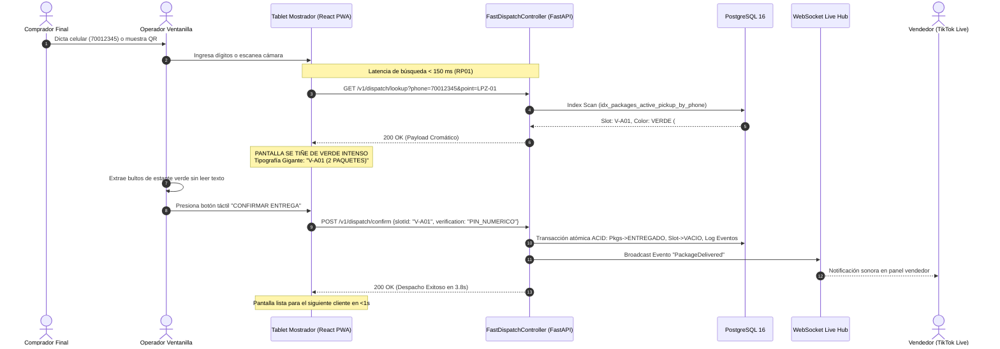

# Modelo de Casos de Uso: Alto Nivel y Casos de Uso Expandidos
**Ingeniería de Software: Modelado Basado en Escenarios según Roger S. Pressman**
*Integración Metodológica: Alistair Cockburn (Writing Effective Use Cases), Craig Larman (Applying UML and Patterns) y Eric Evans (Domain-Driven Design).*
*Sistema: BUZON Xpress S.R.L. - Entregas y Almacenamiento*

---

## 1. Fundamentos del Modelado Basado en Escenarios (Pressman & Cockburn)

Roger S. Pressman establece que el **Modelado Basado en Escenarios** representa la visión del usuario sobre el comportamiento del sistema. Su objetivo primordial es capturar las interacciones funcionales entre los **actores** (entidades humanas o computacionales externas) y las fronteras de los **componentes del software**, estableciendo los contratos funcionales previos al diseño arquitectónico detallado.

Para asegurar un modelado riguroso y de grado industrial, se utiliza la taxonomía de dos niveles articulada por Alistair Cockburn y Craig Larman:
1. **Casos de Uso de Alto Nivel (High-Level / Summary Level):** Describen los objetivos estratégicos y las metas de negocio de gran escala que abarcan el ciclo de vida de los procesos logísticos de BUZON Xpress S.R.L. Agrupan las capacidades del sistema en **8 Módulos Clave**.
2. **Casos de Uso Expandidos (Fully Dressed / Expanded Use Cases):** Describen paso a paso la interacción detallada entre el actor y el sistema, incorporando precondiciones formales, garantías de éxito, flujos alternativos exhaustivos, requisitos de rendimiento (SLA de despacho < 5s, latencia < 150 ms) y escenarios de contingencia offline.

---

## 2. Diagrama Global de Casos de Uso de Alto Nivel (UML / Mermaid)



---

## 3. Catálogo de Casos de Uso de Alto Nivel (Nivel Resumen)

```
┌───────────┬───────────────────────────────────────┬──────────────────────┬──────────────────────────────────────────┐
│ Código    │ Nombre del Caso de Uso de Alto Nivel  │ Actor Primario       │ Objetivo Estratégico de Negocio          │
├───────────┼───────────────────────────────────────┼──────────────────────┼──────────────────────────────────────────┤
│ CU-AN-01  │ Ingesta, Pre-registro y Despacho      │ Vendedor Social      │ Registrar envíos individuales o masivos  │
│           │ Masivo por Vendedores                 │ Commerce             │ generando guías y PINs de retiro rápidos.│
├───────────┼───────────────────────────────────────┼──────────────────────┼──────────────────────────────────────────┤
│ CU-AN-02  │ Recepción Física y Asignación de      │ Operador de          │ Recibir bultos en mostrador con 1 clic   │
│           │ Casilleros Cromáticos en Sucursal     │ Ventanilla           │ y ubicar en estantería por color y tamaño│
├───────────┼───────────────────────────────────────┼──────────────────────┼──────────────────────────────────────────┤
│ CU-AN-03  │ Consolidación Multitienda Inteligente │ Motor Asíncrono /    │ Detectar pedidos al mismo comprador y    │
│           │ de Envíos en la Misma Sucursal        │ Operador             │ agruparlos en una sola celda física.     │
├───────────┼───────────────────────────────────────┼──────────────────────┼──────────────────────────────────────────┤
│ CU-AN-04  │ Búsqueda y Despacho Cromático en      │ Operador de          │ Retirar paquetes en < 5 segundos usando  │
│           │ Mostrador con SLA < 5 segundos        │ Ventanilla           │ interfaz visual teñida por color de celda│
├───────────┼───────────────────────────────────────┼──────────────────────┼──────────────────────────────────────────┤
│ CU-AN-05  │ Recaudación COD (Cobro Contra         │ Operador de          │ Cobrar el producto en ventanilla en Bs   │
│           │ Entrega) y Conciliación de Turno      │ Ventanilla           │ (efectivo o QR Simple) sin discrepancias.│
├───────────┼───────────────────────────────────────┼──────────────────────┼──────────────────────────────────────────┤
│ CU-AN-06  │ Liquidaciones Financieras Masivas     │ Administrador /      │ Transferir a los vendedores los cobros   │
│           │ a Cuentas de Vendedores               │ Finanzas             │ COD descontando tarifas de servicio.     │
├───────────┼───────────────────────────────────────┼──────────────────────┼──────────────────────────────────────────┤
│ CU-AN-07  │ Trazabilidad, Auditoría Inmutable y   │ Sistema / Daemon     │ Bitácora inalterable (Event Sourcing) y  │
│           │ Sincronización Trilateral WhatsApp    │                      │ avisos inmediatos a las 3 partes.        │
├───────────┼───────────────────────────────────────┼──────────────────────┼──────────────────────────────────────────┤
│ CU-AN-08  │ Operación Resiliente Offline y        │ Operador de          │ Despachar y recibir sin internet en      │
│           │ Sincronización para Ferias de Comercio│ Ventanilla / Tablet  │ ferias con conciliación en segundo plano.│
└───────────┴───────────────────────────────────────┴──────────────────────┴──────────────────────────────────────────┘
```

---

## 4. Casos de Uso Expandidos por Módulo (Fully Dressed)

---

### MÓDULO 1: INGESTA Y PRE-REGISTRO MASIVO
#### Caso de Uso Expandido: CU-EXP-01.1 Pre-registro Masivo de Pedidos desde Transmisiones TikTok Live / WhatsApp

* **Identificador:** `CU-EXP-01.1`
* **Nivel:** Nivel de Objetivo de Usuario (User Goal).
* **Actor Primario:** Vendedor Social Commerce (Emprendedor).
* **Actores Secundarios / de Soporte:** Servicio de Mensajería WhatsApp, Servicio de Generación Criptográfica de Tokens QR.
* **Stakeholders e Intereses:**
  * *Vendedor:* Necesita cargar entre 20 y 100 pedidos inmediatamente después de una transmisión en vivo sin perder tiempo llenando formularios lentos ni direcciones domiciliarias complejas.
  * *BUZON Xpress:* Asegurar datos válidos del comprador (teléfono boliviano de 8 dígitos) e importes claros de Cobro Contra Entrega (COD).
  * *Comprador:* Recibir una confirmación temprana de que su pedido está reservado y en preparación.
* **Precondiciones:**
  1. El vendedor ha iniciado sesión en el portal web de BUZON Xpress con cuenta activa y verificada.
  2. El vendedor tiene seleccionado el punto de custodia de destino (ej. Casa Matriz La Paz).
* **Garantías de Éxito (Poscondiciones):**
  * Se crean los registros de paquetes en la base de datos central en estado `PRE_REGISTRADO`.
  * Se genera para cada paquete un código de rastreo único (`tracking_number`, ej. `BX-LPZ-2026-X892`), un PIN numérico secreto (`pickup_pin`) y un token QR firmado.
  * Se genera una hoja de manifiesto PDF con códigos de barra / QR resumidos para imprimir o llevar en el celular.
  * Se emite evento `PRE_REGISTRO_CREADO` en la bitácora inmutable `custody_events`.
* **Disparador (Trigger):** El vendedor concluye su venta en vivo o recopila su lista de WhatsApp y presiona "Nuevo Despacho por Lote" en su panel.



* **Escenario Principal de Éxito (Flujo Básico / Happy Path):**
  1. El vendedor accede a la sección "Pre-registro Rápido" en la plataforma.
  2. El sistema solicita la sucursal de depósito inicial y la sucursal o punto de retiro para los compradores.
  3. El vendedor introduce los datos de los envíos pegando texto en bloque o completando la tabla de carga rápida:
     * Teléfono móvil del comprador (8 dígitos).
     * Nombre del destinatario.
     * Descripción breve del producto (ej. "Blusa Seda Negra").
     * Monto a cobrar contra entrega (COD en Bs; `0.00` si ya fue pagado por QR previo).
  4. El sistema valida en tiempo real la sintaxis de los teléfonos y números positivos de importes.
  5. El vendedor presiona "Confirmar y Generar Lote".
  6. El sistema crea atómicamente los registros de paquetes en estado `PRE_REGISTRADO`.
  7. El sistema calcula las tarifas correspondientes de acuerdo al plan del vendedor (5 Bs estándar o 3.50 Bs Pro).
  8. El sistema proyecta la lista de etiquetas con código de guía y ofrece la descarga del Manifiesto de Depósito en ventanilla.
* **Extensiones y Flujos Alternativos:**
  * *4a. Teléfono inválido o de formato incorrecto:*
    * El sistema resalta la celda en color rojo y especifica "Debe contener 8 dígitos comenzando con 6 o 7". El vendedor corrige el valor y continúa.
  * *6a. Pérdida transitoria de conexión a internet:*
    * El portal web retiene la información en el almacenamiento local del navegador (`sessionStorage`) y reintenta con backoff exponencial. Al reconectar, despacha la carga sin pérdida de datos.
  * *7a. Vendedor calificado en Plan Pro:*
    * El sistema aplica automáticamente la tarifa bonificada de 3.50 Bs y actualiza el contador de envíos del periodo.
* **Requisitos Especiales:**
  * Capacidad de procesar hasta 200 paquetes en una sola petición HTTP en tiempo < 800 ms.
  * Generación de identificadores de seguimiento alfanuméricos cortos y legibles para comprobantes térmicos.

---

### MÓDULO 2: RECEPCIÓN FÍSICA Y ASIGNACIÓN DE CASILLEROS CROMÁTICOS
#### Caso de Uso Expandido: CU-EXP-02.1 Recepción de Lotes y Asignación Algorítmica de Celda Cromática

* **Identificador:** `CU-EXP-02.1`
* **Nivel:** Nivel de Objetivo de Usuario.
* **Actor Primario:** Operador de Ventanilla / Mostrador.
* **Actores Secundarios:** Vendedor que entrega, Motor de Asignación Cromática.
* **Precondiciones:**
  1. El operador tiene la terminal de punto abierta y autenticada con su usuario en turno (`EN_TURNO`).
  2. El vendedor entrega físicamente los paquetes pre-registrados en el mostrador.
  3. Existen casilleros disponibles o con capacidad de consolidación en la sucursal.
* **Garantías de Éxito:**
  * El paquete pasa a estado `UBICADO_EN_CASILLERO` o `LISTO_PARA_RETIRO`.
  * El casillero físico queda vinculado al paquete y su contador de ocupación se incrementa.
  * El fondo de la celda cromática se actualiza en el plano visual del operador.
  * Se emite evento `RECEPCION_EN_SUCURSAL` y `ASIGNACION_CASILLERO` en `custody_events`.
* **Disparador:** El operador escanea con la cámara o lector de código de barras el manifiesto o paquete presentado por el vendedor.



* **Escenario Principal de Éxito:**
  1. El operador apunta el lector al código de barras del paquete o digita los 4 últimos dígitos del tracking.
  2. El sistema localiza el registro pre-registrado en menos de 100 ms.
  3. El sistema ejecuta el algoritmo de asignación física:
     * Evalúa si el `buyer_phone` ya tiene paquetes no retirados en alguna celda física de la sucursal.
     * Si no tiene, selecciona la siguiente celda libre (`status = 'VACIO'`) respetando el tamaño del bulto y balanceando la carga entre bloques cromáticos (Verde, Rojo, Azul, Amarillo).
  4. La pantalla de la tableta del operador se ilumina con el color correspondiente y muestra en caracteres gigantes el casillero asignado (ej. **VERDE: V-A01**).
  5. El operador coloca físicamente el paquete en el casillero indicado sin necesidad de leer etiquetas diminutas.
  6. El sistema transacciona el paquete a estado `LISTO_PARA_RETIRO`, vincula `current_slot_id`, incrementa `current_package_count` en la celda y dispara la notificación de retiro al comprador.
* **Extensiones y Flujos Alternativos:**
  * *3a. La sucursal tiene todas las celdas físicas ocupadas:*
    * El sistema alerta al operador: "Sin celdas exclusivas libres: Se habilita zona de sobreflujo / estante temporal B-TEMP". El sistema asigna código `OVR-01` en color neutro hasta que se liberen celdas por retiros.
  * *6a. Paquete presenta daños visibles o embalaje roto:*
    * El operador presiona "Reportar Incidencia", toma una fotografía rápida con la tablet y selecciona "Recepción Condicional con Observación". Se notifica al vendedor inmediatamente.

---

### MÓDULO 3: CONSOLIDACIÓN MULTITIENDA INTELIGENTE
#### Caso de Uso Expandido: CU-EXP-03.1 Detección y Fusión Automática de Casillero Multitienda

* **Identificador:** `CU-EXP-03.1`
* **Nivel:** Nivel de Subfunción / Regla de Negocio Automatizada.
* **Actor Primario:** Motor de Consolidación (Sistema Daemon) / Operador de Ventanilla.
* **Actores Secundarios:** Vendedores múltiples (ej. Tienda A de Ropa + Tienda B de Cosméticos), Comprador común.
* **Precondiciones:**
  1. Un nuevo paquete llega físicamente a la sucursal con destinatario `buyer_phone`.
  2. Ya existe en la misma sucursal al menos un paquete almacenado con el mismo `buyer_phone` en una celda en estado `PARCIALMENTE_OCUPADO`.
* **Garantías de Éxito:**
  * El nuevo paquete es ubicado en la **misma celda cromática** que el paquete previo.
  * Se crea o actualiza la cabecera en la tabla `consolidations` y se asocian en `consolidation_packages`.
  * Se suma el importe total de Cobro Contra Entrega (`total_cod_amount`).
  * El comprador recibe una sola notificación unificada: *"¡Tus 2 pedidos de diferentes tiendas ya están listos en la celda V-A01!"*.
* **Escenario Principal de Éxito:**
  1. Durante la ingesta del nuevo paquete, el sistema consulta el índice especializado:
     `idx_locker_slots_consolidation_lookup (delivery_point_id, current_buyer_phone)`.
  2. El sistema detecta coincidencia: la celda `V-A01` contiene 1 paquete del vendedor "Boutique La Paz" para el cliente 70012345.
  3. El sistema valida que la capacidad física de la celda no se sobrepase (`current_package_count < max_package_capacity`).
  4. El sistema emite la directiva de consolidación:
     * Asigna `current_slot_id = V-A01` al nuevo paquete.
     * Incrementa el contador de la celda a 2 paquetes.
     * Actualiza el estado de la celda a `PARCIALMENTE_OCUPADO` o `LLENO`.
  5. La pantalla del operador muestra: **"CONSOLIDACIÓN AUTOMÁTICA: Agrupar con paquete existente en V-A01 (Verde)"**.
  6. El operador junta ambos paquetes en la misma celda.
* **Extensiones:**
  * *3a. El volumen de los paquetes consolidados excede la capacidad física del casillero:*
    * El sistema sugiere al operador: *"Reubicar lote consolidado a celda de mayor tamaño (ej. Celda Azul A-A01 GRANDE)"*. El operador confirma con 1 toque en pantalla y traslada ambos paquetes a la celda grande liberando la celda pequeña.

---

### MÓDULO 4: DESPACHO CROMÁTICO EN VENTANILLA (< 5 SEGUNDOS)
#### Caso de Uso Expandido: CU-EXP-04.1 Despacho Asistido por Bloques de Color con SLA < 5 segundos

* **Identificador:** `CU-EXP-04.1`
* **Nivel:** Nivel de Objetivo de Usuario (El Core Competitivo de BUZON Xpress S.R.L.).
* **Actor Primario:** Operador de Ventanilla.
* **Actores Secundarios:** Comprador Final (Destinatario).
* **Stakeholders e Intereses:**
  * *Comprador:* Retirar su compra en segundos, sin filas, mostrando su celular o dictando su número.
  * *Operador:* Atender sin fatiga cognitiva, guiado visualmente por bloques gigantes de color en su pantalla táctil sin leer etiquetas pequeñas.
  * *Vendedor:* Saber en milisegundos que su cliente ya tiene el producto en mano.
* **Precondiciones:**
  1. El comprador se presenta físicamente en la ventanilla de la sucursal.
  2. Uno o más paquetes del comprador se encuentran físicamente en estado `LISTO_PARA_RETIRO`.
  3. El operador se encuentra en pantalla de despacho continuo ("Modo Cero Filas").
* **Garantías de Éxito:**
  * Los paquetes pasan a estado `ENTREGADO`.
  * La celda física queda liberada en estado `VACIO` (`current_buyer_phone = NULL`, `current_package_count = 0`).
  * Se genera la transacción en `dispatch_transactions`.
  * Se registra la métrica en `pos_sla_metrics` constatando entrega en < 5 segundos.
  * Se emiten eventos en tiempo real a la consola del vendedor.
* **Disparador:** El comprador presenta su código QR en la pantalla de su teléfono o dicta los dígitos de su número de celular.



* **Escenario Principal de Éxito:**
  1. El comprador dicta su número telefónico (ej. `70012345`) o coloca su celular frente a la cámara de la tableta.
  2. La aplicación consulta el endpoint de despacho en menos de 150 ms.
  3. La interfaz adopta de inmediato el color de fondo del casillero correspondiente (ej. **VERDE ESMERALDA #10B981**) y proyecta en tamaño gigante:
     * Código de celda: **`V-A01`**.
     * Cantidad de paquetes: **`2 PAQUETES CONSOLIDADOS`**.
     * Monto a cobrar: **`0.00 Bs (PAGADO PREVIAMENTE)`**.
     * Nombre de referencia del cliente: **`Ana M.`**.
  4. El operador visualiza el color verde, estira el brazo directamente a la gaveta `V-A01` de la estantería verde y toma los paquetes.
  5. El comprador valida verbalmente su PIN de seguridad o presenta su credencial.
  6. El operador presiona el botón físico o táctil de pantalla completa "Confirmar Entrega".
  7. El sistema transacciona atómicamente:
     * Actualiza el estado de los paquetes a `ENTREGADO`.
     * Registra la marca de tiempo `delivered_at = NOW()`.
     * Restablece la celda física a `status = 'VACIO'` con `version = version + 1`.
     * Guarda la transacción en `dispatch_transactions`.
     * Registra en `pos_sla_metrics` el tiempo total de entrega (ej. 3.4 segundos).
  8. La pantalla emite un tono auditivo de éxito y queda instantáneamente limpia para recibir al siguiente usuario en cola.
* **Extensiones y Flujos Alternativos:**
  * *3a. El paquete requiere Cobro Contra Entrega (COD > 0 Bs):*
    * La pantalla cromática incluye un panel inferior destacado con el monto exacto en Bolivianos y activa el subflujo `CU-EXP-05.1` (Cobro en Efectivo o QR Simple). La entrega solo se confirma al verificar el pago.
  * *5a. El cliente no recuerda su PIN de retiro:*
    * El operador selecciona "Enviar PIN por WhatsApp al titular". El sistema dispara un mensaje de texto inmediato al celular registrado con el PIN en negrita. El cliente lo muestra y se efectúa la entrega.
  * *7a. Conflicto de concurrencia optimista (otro operador manipuló la celda milisegundos antes):*
    * El motor detecta discrepancia en la columna `version`, cancela la mutación y reconsulta el estado real en < 50 ms sin bloquear la base de datos ni provocar entregas dobles.

---

### MÓDULO 5: RECAUDACIÓN COD Y CONCILIACIÓN DE CAJA
#### Caso de Uso Expandido: CU-EXP-05.1 Recaudación Contra Entrega con QR Interoperable Simple / Efectivo

* **Identificador:** `CU-EXP-05.1`
* **Nivel:** Nivel de Subfunción Transaccional.
* **Actor Primario:** Operador de Ventanilla.
* **Actores Secundarios:** Comprador Final, Pasarela QR Simple de la Banca Boliviana.
* **Precondiciones:**
  1. El paquete a entregar tiene `cod_amount > 0.00` y `cod_status = 'PENDIENTE_COBRO'`.
  2. El operador se encuentra ejecutando el despacho en ventanilla.
* **Garantías de Éxito:**
  * Se registra el cobro en la tabla `cod_collections` con su método de pago y comprobante.
  * El paquete pasa a `cod_status = 'COBRADO_EN_VENTANILLA'`.
  * Los fondos ingresan a la custodia formal del operador para el arqueo de cierre de turno.
* **Escenario Principal de Éxito:**
  1. Al consultar los paquetes del cliente, el sistema visualiza: **"COBRAR EN VENTANILLA: 150.00 Bs"**.
  2. El operador consulta al comprador su medio preferido: ¿Efectivo o QR Simple?
  3. *Si el comprador elige QR Simple:*
     * El operador presiona "Cobrar con QR".
     * La pantalla táctil genera un QR interoperable dinámico con el monto exacto codificado.
     * El comprador escanea desde la app móvil de cualquier banco de Bolivia (Bcp, Banco Unión, BISA, BNB, Mercantil, Ganadero, etc.).
     * La tableta detecta la confirmación de pago en tiempo real mediante webhook/polling interno.
  4. *Si el comprador elige Efectivo:*
     * El operador recibe el dinero en billetes, valida su legitimidad e introduce el monto recibido. El sistema calcula el cambio exacto.
  5. El operador presiona "Pago Recibido".
  6. El sistema crea el registro en `cod_collections` vinculado a la transacción de despacho.
  7. Se autoriza la entrega física de los productos.
* **Extensiones:**
  * *3a. El comprador no tiene fondos o cancela la compra en mostrador:*
    * El comprador decide no retirar el producto. El operador selecciona "Rechazado en Ventanilla por Comprador".
    * El paquete no se entrega, se retorna a la celda física en estado `DEVUELTO_A_VENDEDOR` y se alerta al vendedor inmediatamente para acordar la reposición o devolución sin pérdidas.

---

### MÓDULO 6: LIQUIDACIONES FINANCIERAS A VENDEDORES
#### Caso de Uso Expandido: CU-EXP-06.1 Generación y Ejecución de Corte de Liquidación a Vendedores

* **Identificador:** `CU-EXP-06.1`
* **Nivel:** Nivel de Proceso Administrativo y Financiero.
* **Actor Primario:** Administrador del Sistema / Encargado de Finanzas.
* **Actores Secundarios:** Vendedor Beneficiario, Sistema Bancario ACH / QR Simple Pagos.
* **Precondiciones:**
  1. Existen paquetes entregados con `cod_status = 'COBRADO_EN_VENTANILLA'` no liquidados previamente.
  2. El vendedor tiene registrados y validados sus datos de abono (Cuenta de banco o QR Simple).
* **Garantías de Éxito:**
  * Se genera una cabecera en `seller_settlements` con numeración consecutiva (`LIQ-2026-XXXXX`).
  * Los paquetes incluidos se asocian en `settlement_items` y transicionan a `cod_status = 'LIQUIDADO_A_VENDEDOR'`.
  * El vendedor recibe un estado de cuenta en PDF por WhatsApp/Email con el desglose exacto de lo recaudado y las comisiones descontadas.
* **Escenario Principal de Éxito:**
  1. El responsable financiero entra al módulo "Cortes y Liquidaciones" al finalizar el ciclo semanal o diario.
  2. El sistema calcula automáticamente por vendedor:
     * Suma bruta de dinero recaudado en ventanillas por ventas COD (`gross_cod_collected`).
     * Deducción de tarifas de custodia de BUZON Xpress (`total_service_fees_deducted`).
     * Monto líquido neto a abonar (`net_payout_amount = gross - fees`).
  3. El administrador revisa el consolidado y presiona "Procesar Liquidaciones".
  4. El sistema emite la orden de transferencia bancaria por ACH o genera el comprobante de pago por QR Simple.
  5. Una vez efectuado el abono bancario, el administrador adjunta la referencia de la transferencia (`payout_reference`).
  6. El sistema marca la liquidación como `PAGADO` y envía el comprobante digital al WhatsApp del vendedor.

---

### MÓDULO 7: TRAZABILIDAD Y AUDITORÍA INMUTABLE
#### Caso de Uso Expandido: CU-EXP-07.1 Emisión Inmutable de Evento de Custodia y Sincronización Trilateral

* **Identificador:** `CU-EXP-07.1`
* **Nivel:** Nivel de Subfunción Transversal (Event Sourcing).
* **Actor Primario:** Motor de Eventos Central (Daemon / PostgreSQL Trigger).
* **Actores Secundarios:** Vendedor, Comprador, Pasarela WhatsApp, WebSocket Gateway.
* **Precondiciones:**
  * Ocurre cualquier cambio de estado físico o lógico en una entidad `Package` o `LockerSlot`.
* **Garantías de Éxito:**
  * Se inserta un registro *append-only* en `custody_events` garantizando que no pueda ser editado ni borrado (`UPDATE` y `DELETE` bloqueados a nivel de permisos de base de datos).
  * Se despacha el mensaje informativo al WhatsApp del comprador o vendedor según corresponda.
  * Se actualiza la consola en vivo del vendedor vía WebSockets.
* **Escenario Principal de Éxito:**
  1. La máquina de estados transiciona un paquete (ej. de `RECIBIDO_EN_SUCURSAL` a `LISTO_PARA_RETIRO`).
  2. El trigger de base de datos `trg_audit_package_state` intercepta el cambio y registra en `custody_events`:
     * ID del paquete y nuevo estado.
     * Sucursal y casillero asignado (`V-A01`).
     * Actor que lo operó (ID del operador).
     * Carga útil JSON estructurada con marcas de tiempo atómicas.
  3. El backend emite un mensaje a la cola de eventos de WhatsApp:
     * *Mensaje a Comprador:* *"¡Hola Ana! Tu paquete de 'Moda Bolivia' está listo para retiro en Casa Matriz La Paz (Calle 15). Muestra tu PIN secreto: 4918 o tu QR adjunto para retirar en ventanilla en menos de 5 segundos"*.
  4. El backend emite evento por WebSocket al canal privado del vendedor: la interfaz web actualiza la insignia a color verde sin necesidad de recargar la página.

---

### MÓDULO 8: RESILIENCIA OFFLINE PARA FERIAS COMERCIALES
#### Caso de Uso Expandido: CU-EXP-08.1 Despacho Offline en Tablet y Sincronización Idempotente con Journal

* **Identificador:** `CU-EXP-08.1`
* **Nivel:** Nivel de Resiliencia Operativa / Tolerancia a Fallos (Sommerville & Pressman RR01).
* **Actor Primario:** Operador de Punto en Feria Comercial (ej. Feria de La Cancha o El Alto sin internet continuo).
* **Actores Secundarios:** Motor de Sincronización Offline (IndexedDB / Sync Journal).
* **Precondiciones:**
  1. La tablet del operador cuenta con la aplicación PWA cargada en memoria.
  2. La tableta pierde temporalmente la conexión WiFi y red móvil 4G/5G.
* **Garantías de Éxito:**
  * El operador continúa despachando y recibiendo paquetes con la misma fluidez (< 5s).
  * Las transacciones se almacenan criptográficamente en el almacenamiento local de la tablet (`IndexedDB`).
  * Al restaurarse la red, las operaciones se sincronizan de forma idempotente con el servidor central sin provocar duplicados ni inconsistencias.
* **Escenario Principal de Éxito:**
  1. El operador detecta indicador visual en la barra superior: **"Modo Local Offline Activo (Base de Datos Local)"**.
  2. El comprador se presenta y muestra su código QR o dicta su teléfono.
  3. La tableta busca en la base de datos local pre-sincronizada en IndexedDB y localiza el paquete y celda en < 50 ms.
  4. La pantalla se tiñe del color del bloque correspondiente (ej. **ROJO #D91438**) con código de celda `R-A01`.
  5. El operador entrega el paquete y presiona "Confirmar Entrega Offline".
  6. La aplicación local guarda la transacción en la cola de IndexedDB generando un UUIDv4 propio y estampando la fecha y hora local del dispositivo.
  7. El comprador retira su paquete sin demoras.
  8. Cuando el dispositivo detecta conexión de red (evento `window.ononline`):
     * El sincronizador despacha la cola de operaciones pendientes al endpoint `/v1/sync/journal`.
     * El backend procesa cada registro de forma idempotente en la tabla `offline_sync_journal`, valida que no existan conflictos y actualiza el estado central a `ENTREGADO`.
     * El indicador de la tablet cambia a **"Conectado y 100% Sincronizado"**.
* **Extensiones:**
  * *8a. Conflicto de concurrencia durante el periodo desconectado:*
    * El backend aplica la estrategia de resolución basada en reglas de dominio (*Last-State-Authority*): si el paquete fue reportado como entregado offline, prevalece la entrega física constatada por el operador y se registra una nota explicativa en `conflict_notes`.

---

## 5. Matriz de Trazabilidad: Casos de Uso vs. Entidades de Base de Datos

```
┌──────────────────────────────────────┬────────────────────────────────────────────────────────────────────────┐
│ Caso de Uso Expandido                │ Entidades Relacionales Afectadas (CRUD)                                │
├──────────────────────────────────────┼────────────────────────────────────────────────────────────────────────┤
│ CU-EXP-01.1 Pre-registro Masivo      │ • packages (Create)                                                    │
│                                      │ • custody_events (Create)                                              │
│                                      │ • users / seller_profiles (Read)                                       │
├──────────────────────────────────────┼────────────────────────────────────────────────────────────────────────┤
│ CU-EXP-02.1 Recepción y Casillero    │ • packages (Update: current_slot_id, state)                            │
│                                      │ • locker_slots (Update: status, current_package_count)                 │
│                                      │ • custody_events (Create)                                              │
├──────────────────────────────────────┼────────────────────────────────────────────────────────────────────────┤
│ CU-EXP-03.1 Consolidación Multitienda│ • consolidations (Create / Update)                                     │
│                                      │ • consolidation_packages (Create)                                      │
│                                      │ • locker_slots (Update: current_buyer_phone)                           │
│                                      │ • packages (Update: consolidation_id)                                  │
├──────────────────────────────────────┼────────────────────────────────────────────────────────────────────────┤
│ CU-EXP-04.1 Despacho Ventanilla <5s  │ • packages (Update: state='ENTREGADO', delivered_at)                   │
│                                      │ • locker_slots (Update: status='VACIO', current_package_count=0)       │
│                                      │ • dispatch_transactions (Create)                                       │
│                                      │ • pos_sla_metrics (Create)                                             │
│                                      │ • custody_events (Create)                                              │
├──────────────────────────────────────┼────────────────────────────────────────────────────────────────────────┤
│ CU-EXP-05.1 Recaudación COD          │ • cod_collections (Create)                                             │
│                                      │ • packages (Update: cod_status='COBRADO_EN_VENTANILLA')                │
│                                      │ • dispatch_transactions (Update: total_cod_collected)                  │
├──────────────────────────────────────┼────────────────────────────────────────────────────────────────────────┤
│ CU-EXP-06.1 Liquidaciones Vendedores │ • seller_settlements (Create)                                          │
│                                      │ • settlement_items (Create)                                            │
│                                      │ • packages (Update: cod_status='LIQUIDADO_A_VENDEDOR')                 │
│                                      │ • seller_profiles (Read / Update)                                      │
├──────────────────────────────────────┼────────────────────────────────────────────────────────────────────────┤
│ CU-EXP-07.1 Auditoría Inmutable      │ • custody_events (Create - Append Only)                                │
├──────────────────────────────────────┼────────────────────────────────────────────────────────────────────────┤
│ CU-EXP-08.1 Resiliencia Offline      │ • offline_sync_journal (Create / Reconcile)                            │
│                                      │ • packages / dispatch_transactions (Sync Update)                       │
└──────────────────────────────────────┴────────────────────────────────────────────────────────────────────────┘
```
