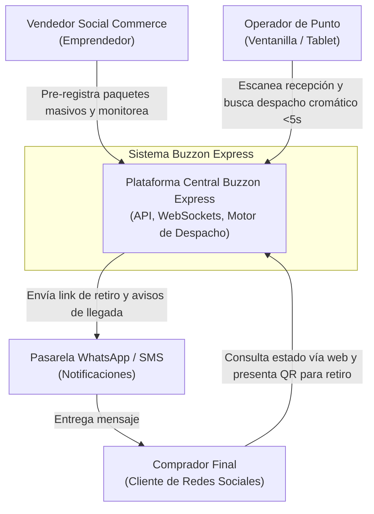
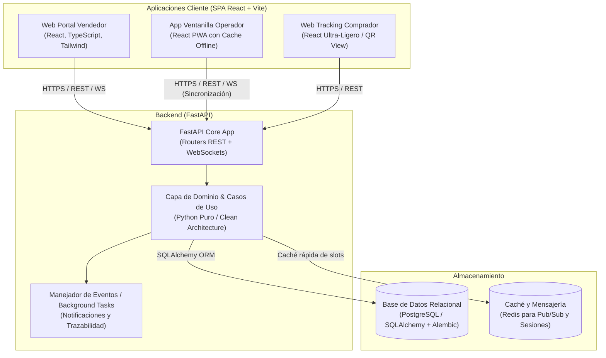

# Especificación de Ingeniería de Software: Buzzon Express
**Marco Metodológico de Arquitectura, Dominio y Desarrollo Ágil**
*Basado en los marcos de Eric Evans (DDD), Robert C. Martin (Clean Architecture), Simon Brown (C4 Model), Jeff Patton (User Story Mapping), Roger Pressman (FURPS+) y Jez Humble (DevOps).*

---

## 1. Visión Técnica y Alcance del Sistema

**Buzzon Express** es un sistema distribuido en tiempo real orientado a coordinar la logística de última milla para micro-vendedores de comercio social, operadores de casilleros y compradores. El software garantiza un tiempo de entrega en ventanilla inferior a 5 segundos a través de una arquitectura optimizada para la interacción visual asistida por colores y la sincronización trilateral continua.

---

## 2. Ingeniería de Requisitos: Modelo FURPS+ (Roger Pressman / IEEE 29148)

```
┌─────────────────────────┬────────────────────────────────────────────────────────────────────────┐
│ Categoría FURPS+        │ Especificación Técnica y Criterio de Medición                          │
├─────────────────────────┼────────────────────────────────────────────────────────────────────────┤
│ F - Functionality       │ • RF01: Pre-registro de paquetes por parte del Vendedor (web).         │
│ (Funcionalidad)         │ • RF02: Generación algorítmica de código de ubicación cromático.       │
│                         │ • RF03: Consolidación automática de envíos por número de comprador.    │
│                         │ • RF04: Módulo de recepción y asignación con escaneo rápido en 1 clic. │
│                         │ • RF05: Búsqueda visual indexada por teléfono/código QR (< 5 seg).     │
│                         │ • RF06: Muro de tracking ligero para comprador sin login obligatorio.  │
│                         │ • RF07: Sincronización trilateral de estados mediante eventos.         │
├─────────────────────────┼────────────────────────────────────────────────────────────────────────┤
│ U - Usability           │ • RU01: UX Cromática: Bloques de color gigantes de alto contraste     │
│ (Usabilidad)            │   (elimina la fatiga visual de leer textos pequeños en ventanilla).    │
│                         │ • RU02: Operabilidad a 1 mano y modo táctil para tablet de mostrador.  │
│                         │ • RU03: Accesibilidad web en smartphones de gama baja (Android Go).    │
├─────────────────────────┼────────────────────────────────────────────────────────────────────────┤
│ R - Reliability         │ • RR01: Tolerancia a caídas de red: Cola local IndexedDB en frontend   │
│ (Confiabilidad)         │   de operador que sincroniza con el backend cuando vuelve internet.    │
│                         │ • RR02: Idempotencia en la confirmación de entregas (previene dobles   │
│                         │   despachos accidentales).                                             │
├─────────────────────────┼────────────────────────────────────────────────────────────────────────┤
│ P - Performance         │ • RP01: Tiempo de respuesta del endpoint de búsqueda < 150 ms (P95).   │
│ (Rendimiento)           │ • RP02: Tiempo de resolución de escaneo QR de comprador < 300 ms.      │
│                         │ • RP03: Peso del bundle frontend comprador < 150 KB gzip.              │
├─────────────────────────┼────────────────────────────────────────────────────────────────────────┤
│ S - Supportability      │ • RS01: Arquitectura desacoplada en FastAPI con contratos OpenAPI 3.0. │
│ (Mantenibilidad)        │ • RS02: Cobertura de pruebas unitarias y de integración > 80%.         │
├─────────────────────────┼────────────────────────────────────────────────────────────────────────┤
│ + (Restricciones)       │ • Stack: Python 3.11+ (FastAPI), React 18+ (TypeScript + TailwindCSS). │
│                         │ • Base de Datos: PostgreSQL relacional con soporte ACID estricto.      │
└─────────────────────────┴────────────────────────────────────────────────────────────────────────┘
```

---

## 3. Diseño Guiado por el Dominio (DDD - Eric Evans)

### 3.1. Lenguaje Ubicuo (Ubiquitous Language)
Para eliminar la ambigüedad entre el negocio y el código, se establecen los siguientes términos de dominio canónicos:
* **Package (Paquete):** Unidad física individual pre-registrada o depositada que contiene bienes a entregar.
* **Locker (Casillero / Celda):** Espacio físico identificado dentro de un punto de custodia (ej. Bloque `Verde`, Celda `V-A01`).
* **Consolidation (Consolidación):** Agrupación lógica de múltiples paquetes dirigidos al mismo número de comprador en una misma celda física.
* **ChromaticTag (Código de Color / Etiqueta Visual):** Tupla de color primario y código alfanumérico visible asignado a la celda para despacho instantáneo.
* **CustodyEvent (Evento de Custodia):** Registro inmutable en el historial del paquete (*Pre-registrado, Recibido_En_Punto, En_Casillero, Listo_Para_Retiro, Entregado, Devuelto*).
* **DeliveryPoint (Punto de Custodia):** Ubicación física (local comercial/sucursal) donde operan los casilleros.

### 3.2. Bounded Contexts (Contextos Delimitados)

```
┌─────────────────────────────────────────────────────────────────────────────────────────────┐
│                                MAPA DE CONTEXTOS (BOUNDED CONTEXTS)                         │
└─────────────────────────────────────────────────────────────────────────────────────────────┘

    ┌───────────────────────────┐                      ┌───────────────────────────┐
    │  CONTEXTO DE INGESTA Y    │                      │  CONTEXTO DE CASILLEROS Y │
    │       PRE-REGISTRO        │                      │       ALMACENAMIENTO      │
    ├───────────────────────────┤                      ├───────────────────────────┤
    │ • PreRegistroService      │       Eventos        │ • LockerAllocationService │
    │ • Agregado: Package       │─────────────────────>│ • Agregado: LockerSlot    │
    │ • Validaciones de Teléfono│    PackageCreated    │ • Algoritmo Consolidación │
    └───────────────────────────┘                      └───────────────────────────┘
                  │                                                  │
                  │ Eventos                                          │ Eventos
                  │                                                  │ SlotAssigned
                  ▼                                                  ▼
    ┌───────────────────────────┐                      ┌───────────────────────────┐
    │   CONTEXTO DE DESPACHO    │                      │  CONTEXTO DE TRACKING Y   │
    │        Y VENTANILLA       │                      │       NOTIFICACIONES      │
    ├───────────────────────────┤                      ├───────────────────────────┤
    │ • FastDispatchService     │                      │ • RealtimeTrackingService │
    │ • Verificación QR / Token │                      │ • WebSockets / Webhook    │
    │ • UX Cromática Activa     │                      │ • Interfaz Comprador      │
    └───────────────────────────┘                      └───────────────────────────┘
```

### 3.3. Modelo Táctico (Entidades y Agregados en Dominio)

```
[Agregado: Package]
  ├── PackageId (UUID, Root Entity)
  ├── TrackingNumber (Value Object, ej: BZ-2026-X89J)
  ├── SellerId (UUID)
  ├── BuyerPhone (Value Object)
  ├── Description (String)
  ├── PriceToCollect (Money, COD opcional)
  ├── CurrentState (Enum: PreRegistered, InCustody, ReadyForPickup, Delivered, Cancelled)
  └── History: List[CustodyEvent]

[Agregado: LockerSlot]
  ├── SlotId (UUID, Root Entity)
  ├── PointId (UUID)
  ├── Code (Value Object, ej: "V-A01")
  ├── ChromaticColor (Value Object: ColorHex, ColorName: "Emerald-500")
  ├── AssignedBuyerPhone (Value Object, Nullable)
  ├── StoredPackages: List[PackageId]  <-- Permite Consolidación
  └── Status (Enum: Empty, PartiallyOccupied, Full, Maintenance)
```

---

## 4. Arquitectura del Sistema (Clean Architecture & Simon Brown C4)

### 4.1. Diagrama C4 - Nivel 1: Contexto del Sistema



### 4.2. Diagrama C4 - Nivel 2: Contenedores del Sistema



### 4.3. Estructura de Capas del Backend (Clean Architecture - Robert C. Martin)

El directorio `backend/` implementa la Regla de Dependencia de Uncle Bob (las dependencias solo apuntan hacia adentro):

```
backend/
├── app/
│   ├── domain/               # Capa 1: Entidades puras y reglas de negocio del dominio
│   │   ├── models/           # Package, LockerSlot, CustodyEvent (Pydantic/dataclasses)
│   │   ├── value_objects/    # BuyerPhone, ChromaticTag, Money
│   │   └── exceptions.py     # Errores específicos del negocio (ej. SlotFullException)
│   ├── application/          # Capa 2: Casos de uso del sistema
│   │   ├── use_cases/        # RegisterPackage, AllocateLocker, DispatchByPhone, ConsolidateOrders
│   │   └── interfaces/       # Puertos/Interfaces abstractas (IPackageRepository, INotifier)
│   ├── adapters/             # Capa 3: Adaptadores de entrada y salida
│   │   ├── api/              # Controladores FastAPI (v1/packages.py, v1/dispatch.py)
│   │   ├── repositories/     # Implementaciones concretas de BD con SQLAlchemy
│   │   └── websocket/        # Hub de eventos de presencia y actualización en vivo
│   └── infrastructure/       # Capa 4: Frameworks, drivers y configuración
│       ├── db/               # Sesión de base de datos, migraciones Alembic
│       ├── config.py         # Variables de entorno y settings
│       └── main.py           # Instancia principal de FastAPI
```

---

## 5. User Story Mapping y Plan de Release (Jeff Patton)

Siguiendo la técnica de Jeff Patton, organizamos la columna vertebral de actividades (*Backbone*) y las dividimos en cortes de entrega funcionales (*Walking Skeleton* y releases evolutivos):

```
┌─────────────────────────────────────────────────────────────────────────────────────────────────┐
│                        USER STORY MAP: COLUMNA VERTEBRAL (BACKBONE)                             │
├─────────────────┬───────────────────┬───────────────────┬───────────────────┬───────────────────┤
│ 1. PRE-REGISTRO │ 2. INGESTA EN     │ 3. ASIGNACIÓN Y   │ 4. CONSULTA Y     │ 5. DESPACHO       │
│    VENDEDOR     │    VENTANILLA     │    CONSOLIDACIÓN  │    NOTIFICACIÓN   │    MOSTRADOR <5S  │
├─────────────────┴───────────────────┴───────────────────┴───────────────────┴───────────────────┤
│ RELEASE 1: WALKING SKELETON (MVP Funcional)                                                     │
├─────────────────┬───────────────────┬───────────────────┬───────────────────┬───────────────────┤
│ • Formulario    │ • Escáner manual  │ • Asignación a    │ • Vista web por   │ • Búsqueda por    │
│   rápido de     │   de código de    │   celda estática  │   link directo    │   celular y botón │
│   paquete con   │   paquete para    │   (un paquete por │   para ver estado │   de confirmación │
│   teléfono.     │   confirmar.      │   casillero).     │   básico.         │   de entrega.     │
├─────────────────┴───────────────────┴───────────────────┴───────────────────┴───────────────────┤
│ RELEASE 2: EXPERIENCIA CROMÁTICA & CONSOLIDACIÓN MULTITIENDA                                    │
├─────────────────┬───────────────────┬───────────────────┬───────────────────┬───────────────────┤
│ • Carga masiva  │ • Confirmación con│ • Algoritmo de    │ • Generación de   │ • Pantalla gigante│
│   desde lista   │   1 clic desde    │   detección de    │   QR de retiro    │   de color de alta│
│   de WhatsApp o │   cámara o lector │   paquetes del    │   único para      │   visibilidad     │
│   Live.         │   código de barra.│   mismo comprador.│   todos los envíos│   con ubicación.  │
├─────────────────┴───────────────────┴───────────────────┴───────────────────┴───────────────────┤
│ RELEASE 3: MODO OFFLINE & COBRO COD                                                             │
├─────────────────┬───────────────────┬───────────────────┬───────────────────┬───────────────────┤
│ • Historial y   │ • Cola de ingesta │ • Reasignación    │ • Alertas de push │ • Liquidación y   │
│   métricas de   │   offline con     │   inteligente por │   o bot de        │   cobro QR contra │
│   venta live.   │   IndexedDB.      │   caducidad (>48h)│   WhatsApp.       │   entrega (COD).  │
└─────────────────┴───────────────────┴───────────────────┴───────────────────┴───────────────────┘
```

### Historias de Usuario Clave con Criterios Gherkin (BDD)

#### US01: Búsqueda y Despacho Cromático en Ventanilla
> **Como** Operador de Ventanilla  
> **Quiero** ingresar el número de teléfono del cliente o escanear su QR  
> **Para** ver de inmediato en pantalla completa el bloque de color y código de celda y entregar los paquetes en menos de 5 segundos.

```gherkin
Escenario: Despacho exitoso de paquete consolidado guiado por color
  Dado que el operador tiene abierta la pantalla de despacho en el punto "Central San Pedro"
  Y existen 2 paquetes en el casillero "V-A03" (Color: Verde Esmeralda) asociados al celular "70012345"
  Cuando el operador digita "70012345" o escanea el QR del cliente
  Entonces la pantalla debe iluminarse en color "Verde Esmeralda" de alto contraste
  Y mostrar en texto gigante "CASILLERO V-A03 (2 PAQUETES)"
  Y el tiempo total de renderizado y consulta debe ser menor a 200 milisegundos
  Cuando el operador presiona el botón "Confirmar Entrega"
  Entonces el casillero "V-A03" pasa a estado "Vacío"
  Y ambos paquetes cambian su estado a "Entregado"
  Y el vendedor recibe la notificación de entrega en tiempo real.
```

#### US02: Consolidación Automática por Comprador
> **Como** Sistema Buzzon Express  
> **Quiero** verificar si ya existe un casillero activo con el mismo número de comprador en el punto  
> **Para** asignar el nuevo paquete al mismo casillero físico y reducir el uso de espacio.

```gherkin
Escenario: Asignación consolidada al ingresar segundo paquete de distinta tienda
  Dado que el comprador con celular "71234567" ya tiene un paquete en el casillero "R-B02" (Color: Rojo)
  Cuando el operador recibe un nuevo paquete pre-registrado por otro vendedor para el celular "71234567"
  Entonces el sistema sugiere automáticamente ubicarlo en el casillero "R-B02"
  Y muestra una alerta visual: "Cliente con paquete existente en R-B02 (Consolidar)"
  Y el estado del casillero permanece en "Ocupado (2 paquetes)".
```

---

## 6. Estrategia de Calidad, DevOps y Entrega Continua (Jez Humble / Accelerate)

* **Pipeline de Integración Continua (CI/CD):**
  * Linting y tipado estricto con `mypy` y `ruff` en el backend; `eslint` y `tsc` en el frontend.
  * Suite de pruebas automatizadas con `pytest` para lógica de casos de uso y repositorios en memoria.
* **Métricas DORA a Monitorear:**
  * *Deployment Frequency (Frecuencia de despliegue):* Despliegues continuos semanales.
  * *Lead Time for Changes:* Menor a 24 horas desde commit hasta staging.
  * *Change Failure Rate:* Menor al 5%.
  * *Time to Restore Service (MTTR):* Menor a 30 minutos con reversión atómica en contenedor.
